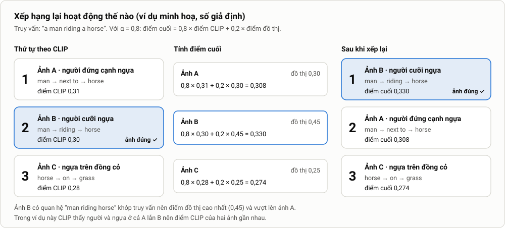

# 1. Bài toán và ý tưởng

## Bài toán: tìm ảnh bằng một câu mô tả

Người dùng gõ một câu tiếng Anh. Hệ thống xếp hạng mọi ảnh trong kho sao cho ảnh khớp câu nhất đứng đầu.

Trong thí nghiệm, kho ảnh của tập test có 1.500 ảnh và có 7.500 câu truy vấn. Mỗi câu là một caption COCO mà người gán nhãn viết cho đúng một ảnh, nên mỗi truy vấn có đúng một ảnh đúng. Ảnh đúng càng đứng gần đầu danh sách thì hệ thống càng tốt.

Ví dụ, với truy vấn *"Woman is just about to cut birthday cake as friends are around."*, ảnh đúng là ảnh `2350042`: một người phụ nữ đang cắt bánh sinh nhật.

Hệ thống làm việc qua 5 bước, mô tả lần lượt dưới đây.

## Bước 1: CLIP chọn ứng viên

CLIP là một mô hình có sẵn của OpenAI; dự án dùng bản ViT-B/32. CLIP biến một ảnh thành một vector 512 số và biến một câu văn thành một vector 512 số **trong cùng một không gian**. Nếu ảnh và câu nói về cùng một thứ thì hai vector nằm gần nhau. Độ gần được đo bằng cosine: giá trị càng lớn thì càng giống.

- CLIP được dùng nguyên, tức **đóng băng**: dự án không huấn luyện lại nó.
- Vector của 10.000 ảnh được tính một lần rồi lưu ra đĩa.
- Khi có truy vấn, CLIP mã hoá câu, so vector câu với vector của mọi ảnh, rồi lấy **k ảnh có cosine cao nhất** làm ứng viên. Giá trị k được chọn trên tập validation.

Chỉ riêng CLIP đã đạt R@1 = 43,89% trên tập test: ở 43,89% số truy vấn, ảnh đúng đứng hạng 1. Đây là mốc để so sánh.

## Bước 2: đồ thị cảnh cho biết ảnh có gì

Mỗi ảnh trong Visual Genome có một **đồ thị cảnh** do người gán nhãn, gồm hai phần:

- **Đối tượng:** các vật có trong ảnh, ví dụ `woman`, `cake`, `candle`, `knife`.
- **Relation (quan hệ):** các bộ ba *chủ thể → vị từ → đối tượng*, ví dụ `woman → cutting → cake` hay `candle → on → cake`.

Đồ thị cảnh nói rõ *vật nào làm gì với vật nào*. Dự án đặt giả thuyết rằng thông tin này bổ sung được cho CLIP. CLIP nén cả bức ảnh vào một vector, nên nắm tốt việc ảnh có những vật gì, nhưng có thể nắm kém hơn việc các vật liên hệ với nhau ra sao. Ablation (tài liệu 4) đã kiểm giả thuyết này. Bỏ hết relation chỉ làm R@1 giảm khoảng 0,56 điểm, nên relation có đóng góp nhưng nhỏ; phần lớn mức tăng đến từ danh sách đối tượng. Bỏ nhãn vị từ hay xáo trộn cạnh chưa cho khác biệt rõ.

Dự án không tự sinh đồ thị cảnh từ ảnh. Đồ thị được lấy sẵn từ nhãn người gán của Visual Genome.

## Bước 3: GraphSAGE nén đồ thị thành vector

GraphSAGE là một mạng nơ-ron chạy trên đồ thị. Ở mỗi tầng, mỗi đỉnh cập nhật vector của mình bằng cách trộn với vector của các đỉnh hàng xóm; việc này lặp lại qua vài tầng.

Trong dự án, GraphSAGE đọc đồ thị cảnh của một ảnh và trả về **một vector đồ thị** gồm 512 số. Vector này được huấn luyện để nằm trong cùng không gian với vector câu của CLIP. Vì vậy, **điểm đồ thị** của một ảnh đối với một truy vấn chỉ đơn giản là cosine giữa vector câu (do CLIP tạo) và vector đồ thị (do GraphSAGE tạo). Chi tiết ở [tài liệu 3](03-mo-hinh.md).

## Bước 4: trộn hai điểm

Với mỗi ứng viên, điểm cuối được tính như sau:

```
điểm cuối = α · điểm CLIP + (1 − α) · điểm đồ thị
```

- α = 1 nghĩa là chỉ dùng CLIP, và kết quả giống hệt CLIP.
- α = 0 nghĩa là chỉ dùng điểm đồ thị.
- α và k được chọn trên tập **validation**, không bao giờ trên tập test.

Mô hình chính chọn được α khoảng 0,8. Như vậy CLIP vẫn giữ phần lớn trọng số, còn điểm đồ thị chủ yếu đổi thứ tự giữa những ảnh có điểm CLIP sát nhau.

Hình dưới là một ví dụ minh hoạ dùng số giả định:



## Bước 5: giải thích kết quả

Với mỗi ảnh trả về, hệ thống lần lượt bỏ từng relation khỏi đồ thị của ảnh, tính lại điểm đồ thị và xem điểm giảm bao nhiêu. Relation nào làm điểm giảm nhiều nhất được xem là đóng góp nhiều nhất. Phép đo này chạy trên chính mô hình đã chấm điểm, nên lời giải thích không phải một mô tả viết thêm sau đó.

## Đo kết quả thế nào

Mỗi truy vấn có đúng một ảnh đúng. **Hạng** là vị trí của ảnh đúng trong danh sách trả về; hạng 1 là đứng đầu.

| Chỉ số | Ý nghĩa | Khi ảnh đúng ở hạng 3 |
|---|---|---|
| R@1 | Tỉ lệ truy vấn có ảnh đúng ở hạng 1 | không được tính (0) |
| R@5 | Tỉ lệ truy vấn có ảnh đúng trong 5 ảnh đầu | được tính (1) |
| R@10 | Tỉ lệ truy vấn có ảnh đúng trong 10 ảnh đầu | được tính (1) |
| MRR | Trung bình của 1 / hạng | 1/3 ≈ 0,33 |

Mỗi chỉ số là trung bình trên 7.500 truy vấn test. Để so sánh, nếu chọn bừa một ảnh trong 1.500 ảnh thì R@1 chỉ đạt 1/1.500 ≈ 0,07%.

Hai luật giữ cho phép đo công bằng:

- **Điểm hoà được tính theo hướng bất lợi.** Nếu một ảnh khác có điểm bằng đúng điểm của ảnh đúng, ảnh kia được xếp trên. Nhờ vậy không phương pháp nào được lợi chỉ vì thứ tự sắp xếp của mảng.
- **Mỗi tập có gallery riêng.** Truy vấn test chỉ được so với 1.500 ảnh test, không bao giờ gặp ảnh train.

## Thuật ngữ

Bảng dưới chỉ là định nghĩa ngắn. [Phụ lục A](phu-luc-a-kien-thuc-nen.md) giải thích kỹ từng mục, kèm công thức và ví dụ bằng số.

| Thuật ngữ | Nghĩa trong dự án |
|---|---|
| Truy vấn | Một câu tiếng Anh (caption COCO) dùng để tìm ảnh |
| Gallery | Tập ảnh được tìm trong đó: 1.500 ảnh của cùng một tập (validation hoặc test) |
| Vector, embedding | Dãy 512 số biểu diễn một ảnh, một câu hoặc một đồ thị |
| Cosine | Độ giống giữa hai vector, nằm trong khoảng từ −1 đến 1 |
| Đóng băng | Mô hình được dùng nguyên, không huấn luyện thêm (như CLIP ở đây) |
| Đồ thị cảnh | Các đối tượng trong ảnh và quan hệ giữa chúng, do người gán nhãn (Visual Genome) |
| Đỉnh, cạnh | Điểm và đường nối của đồ thị |
| Khái niệm | Một loại đối tượng sau khi chuẩn hoá, ví dụ `woman`. Có tất cả 1.778 khái niệm |
| Vị từ | Nhãn của một quan hệ, ví dụ `cutting`, `on`. Có tất cả 493 vị từ |
| Bộ ba, relation | Một quan hệ đầy đủ: chủ thể → vị từ → đối tượng |
| Đỉnh phụ | Đỉnh mang nhãn vị từ, đặt giữa chủ thể và đối tượng (xem tài liệu 3) |
| GraphSAGE | Mạng nơ-ron chạy trên đồ thị; ở đây dùng để nén đồ thị của một ảnh thành một vector |
| InfoNCE | Hàm mất mát dùng khi huấn luyện: kéo vector đồ thị của ảnh lại gần vector caption của chính ảnh đó, đồng thời đẩy xa caption của các ảnh khác |
| Top-k | k ảnh có điểm CLIP cao nhất; đây là các ứng viên được xếp lại |
| α (alpha) | Trọng số của điểm CLIP trong điểm cuối |
| Train / validation / test | Ba tập ảnh: 7.000 ảnh để học, 1.500 ảnh để chọn tham số, 1.500 ảnh để chấm điểm cuối cùng (chỉ chấm một lần) |
| Seed | Số khởi tạo ngẫu nhiên. Mỗi phương pháp có huấn luyện chạy với 3 seed (13, 37, 97) và báo cáo trung bình ± độ lệch chuẩn |
| Rò rỉ dữ liệu | Thông tin của tập test lọt vào lúc huấn luyện hoặc lúc chọn tham số, làm kết quả đẹp một cách giả tạo |
| Ablation | Thí nghiệm bỏ bớt một thành phần để đo đóng góp của thành phần đó |
| Fidelity | Mức độ lời giải thích phản ánh đúng những gì mô hình thật sự dựa vào |

Muốn xem từng con số đi qua 5 bước trên ra sao, đọc [Phụ lục B](phu-luc-b-tinh-tay-tu-dau-den-cuoi.md). Phụ lục này tính tay toàn bộ ví dụ "a man riding a horse".

Tiếp theo: [2. Dữ liệu](02-du-lieu.md).
