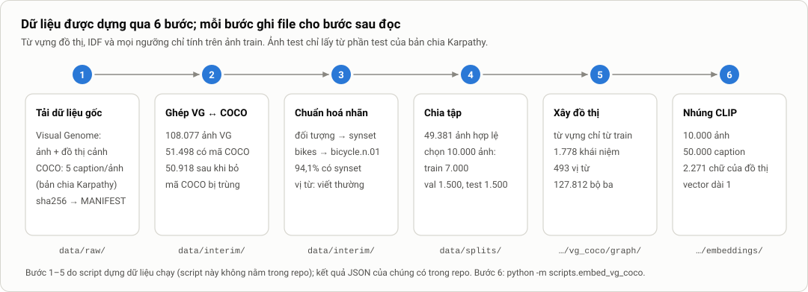
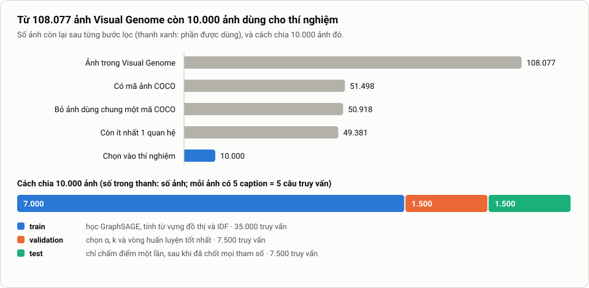

# 2. Dữ liệu

## Hai nguồn, dùng phần giao

| Nguồn | Lấy gì | Vì sao |
|---|---|---|
| Visual Genome (VG) | Ảnh và đồ thị cảnh do người gán: đối tượng và relation | Mỗi ảnh có sẵn một đồ thị |
| COCO, bản chia Karpathy | 5 caption cho mỗi ảnh, kèm nhãn train/val/test theo chuẩn | Caption do người khác viết, độc lập với đồ thị, nên dùng làm truy vấn được |

Dự án chỉ dùng những ảnh **có trong cả hai nguồn** (VG ∩ COCO). Ảnh và đồ thị lấy từ VG; truy vấn là caption COCO của chính ảnh đó.

Vì sao không sinh truy vấn từ đồ thị? Bản thử 40 ảnh trước đây đã làm như vậy, và phương pháp so khớp từ với đồ thị được lợi sẵn, vì truy vấn chứa đúng những chữ có trong đồ thị. Caption COCO được viết độc lập với đồ thị, nên phép so sánh công bằng hơn.

## Sáu bước dựng dữ liệu

1. **Tải dữ liệu gốc.**
   - sha256 của mỗi file thô được ghi trong `data/raw/MANIFEST.json`.
   - Nếu tải lại mà file khác đi, lệnh báo lỗi chứ không ghi đè.
2. **Ghép VG với COCO.**
   - Giữ những ảnh VG có mã COCO và có đủ 5 caption.
   - Có trường hợp hai ảnh VG dùng chung một mã COCO, vì cùng một tấm ảnh được lưu ở hai độ phân giải. Khi đó cả hai ảnh đều bị bỏ, để một tấm ảnh không thể rơi vào hai tập khác nhau.
3. **Chuẩn hoá nhãn.**
   - Tên đối tượng được gộp theo synset WordNet, ví dụ `bike` và `bikes` đều thành `bicycle.n.01`.
   - Đối tượng thiếu synset sẽ mượn synset của các đối tượng cùng tên, với hai điều kiện: tên đó có ít nhất 5 đối tượng, và ít nhất 90% trong số đó mang cùng một synset. Nhờ vậy tỉ lệ đối tượng có synset tăng từ 79,2% lên 94,1%.
   - Vị từ chỉ được chuyển thành chữ thường và gộp khoảng trắng, không quy về synset, vì synset của `on` là `along.r.01`, làm mất nghĩa.
4. **Chia tập.**
   - Dùng scikit-learn với seed 13, phân tầng theo số relation của ảnh.
   - Ảnh test chỉ lấy từ phần test của bản chia Karpathy. Ảnh thuộc phần test Karpathy không bao giờ được đưa vào train hay val.
5. **Xây đồ thị.** Xem mục "Xây đồ thị" bên dưới.
6. **Nhúng CLIP.**
   - Tính vector cho 10.000 ảnh, 50.000 caption và 2.271 chữ trên đồ thị (1.778 khái niệm và 493 vị từ).
   - Vector được chuẩn hoá về độ dài 1, lưu kèm sha256 của dữ liệu đầu vào. Nếu dữ liệu đổi, các bước sau từ chối chạy trên vector cũ.

Kiểm tra sau bước 6 (ở lần nhúng ngày 17/11; ngày 18/11 nhóm tải lại ảnh và tạo lại vector để chạy lại mô hình và ablation):

- Cosine trung bình giữa một caption và đúng ảnh của nó là 0,304; với một ảnh ngẫu nhiên chỉ là 0,152.
- Mã hoá lại một phần nhỏ cho ra cùng vector, sai khác tối đa 3,9 × 10⁻⁷.

## Từ 108.077 ảnh còn 10.000 ảnh

| Tập | Ảnh | Truy vấn | Dùng để |
|---|---|---|---|
| train | 7.000 | 35.000 | Huấn luyện GraphSAGE; tính từ vựng đồ thị và IDF |
| validation | 1.500 | 7.500 | Chọn α, k và vòng huấn luyện tốt nhất |
| test | 1.500 | 7.500 | Chấm điểm một lần, sau khi đã chốt mọi tham số |

Kho 49.381 ảnh hợp lệ đủ để lấy ra 10.000 ảnh. Ngày 17/11, quy mô được nâng từ 5.000 lên 10.000 ảnh.

## Xây đồ thị

Từ vựng của đồ thị được tính **chỉ trên 7.000 ảnh train**:

- **Ngưỡng tần suất.** Một khái niệm phải xuất hiện trong ít nhất 5 ảnh train mới được giữ; vị từ cũng vậy. Kết quả còn 1.778 khái niệm (1.529 khái niệm có synset) và 493 vị từ.
- **Bỏ tên rác.** Có 53 tên bị bỏ: từ chức năng (`the`, `it`), từ chỉ màu đứng một mình (`white`), từ chỉ vị trí (`left`, `top`). Lý do là VG gán cả những tên này vào synset: `he` thành helium, `it` thành information technology.
- **Chữ hiển thị.** Mỗi khái niệm hiển thị bằng tên thô phổ biến nhất của nó trong train; ví dụ khái niệm `trouser` hiển thị là "pants". CLIP cũng đọc đúng chữ này để tạo vector ban đầu cho đỉnh.
- **Mỗi khái niệm là một đỉnh trong ảnh.** Hai người phụ nữ trong cùng một ảnh được gộp thành một đỉnh `woman`.

Ảnh val và test vẫn giữ đồ thị của mình; chỉ những khái niệm và vị từ không có trong từ vựng train là bị bỏ.

| | train | val | test |
|---|---|---|---|
| Đối tượng được giữ lại | 93,3% | 92,7% | 92,5% |
| Relation được giữ lại | 84,8% | 83,8% | 82,5% |
| Số khái niệm mỗi ảnh (trung vị) | 18 | 17 | 17 |
| Số bộ ba mỗi ảnh (trung vị) | 12 | 12 | 12 |
| Số ảnh không còn bộ ba nào | 46 | 7 | 10 |

Tổng cộng có 174.743 đỉnh đối tượng và 127.812 bộ ba trên 10.000 ảnh. Thông số đầy đủ nằm trong `data/splits/vg_coco_graph.yaml`.

Đỉnh xuất hiện nhiều nhất: `man` có mặt trong 31,7% ảnh train; vị từ `on` có mặt trong 85,9%.

## Kiểm trước khi huấn luyện: đồ thị có ích cho truy vấn không?

Trước khi huấn luyện, nhóm đo **độ khớp**: trong các từ nội dung của một caption, bao nhiêu phần trăm xuất hiện trong chữ của đồ thị của chính ảnh đó.

| | Độ khớp trung bình | Tỉ lệ caption có ít nhất một từ khớp |
|---|---|---|
| Đồ thị của chính ảnh | 37,4% | 92,6% |
| Đồ thị của một ảnh ngẫu nhiên | 3,6% | 16,6% |

Đồ thị của đúng ảnh khớp với caption gấp khoảng 10 lần đồ thị của ảnh ngẫu nhiên, nên đồ thị có đủ thông tin để giúp tìm ảnh. Con số 37,4% không phải giới hạn trên của recall; nó chỉ cho thấy điều kiện cần đã thoả.

Những từ trong caption không khớp được chủ yếu thuộc ba loại:

- hành động: `sitting`, `standing`;
- màu sắc và kích thước: `white`, `large`;
- từ chỉ khung cảnh: `street`, `room`.

Tức là đồ thị nắm "có vật gì" tốt hơn "đang làm gì, màu gì". Những truy vấn chỉ khác nhau ở hành động hoặc màu sắc sẽ ít được đồ thị giúp.

## Ví dụ: ảnh 2350042

Năm caption của ảnh, cũng là năm truy vấn trong tập test:

1. "A couple of women sitting next to each other in frotn of a cake." (giữ nguyên lỗi chính tả gốc)
2. "Woman is just about to cut birthday cake as friends are around."
3. "A woman sitting on a sofa cuts a cake while two others watch."
4. "The woman is slicing the festive birthday cake."
5. "Three women in a living room as a birthday cake is cut."

Đồ thị sau bước xây đồ thị:

- **15 khái niệm:** shirt, person, hand, hair, woman, table, arm, foot, chair, girl, pillow, couch, knife, cake, candle.
- **6 bộ ba:** `woman → wearing → shirt`, `woman → next to → woman`, `woman → cutting → cake`, `girl → on → chair`, `pillow → on → couch`, `candle → on → cake`.

Ví dụ này cho thấy cả điểm mạnh lẫn điểm yếu. Đồ thị có `cutting` và `cake`, khớp với truy vấn. Nhưng nó không có "birthday" hay "living room".

## Luật chống rò rỉ dữ liệu

| Luật | Được thực thi ở đâu |
|---|---|
| Từ vựng, chữ hiển thị, IDF và ngưỡng lọc chỉ tính trên ảnh train | `src/data/graph_build.py`, `src/retrieval/lexical.py`. Có test kiểm rằng từ vựng không đổi khi sửa ảnh val/test |
| Ảnh Karpathy test không vào train/val | `src/data/splits.py` và test đi kèm |
| Caption không được trộn vào đồ thị ảnh (nếu trộn, ảnh test sẽ mang sẵn đáp án) | Quyết định D7 |
| α, k và vòng tốt nhất chỉ được chọn trên validation | `sweep_alpha_and_k` báo lỗi nếu nhận một tập khác validation |
| Huấn luyện chỉ dùng ảnh và caption của train (để học) và của val (để chọn vòng) | `scripts/train_graphsage.py` chỉ dựng hai tập này |
| Vector cũ hơn dữ liệu bị từ chối | `verify_inputs_unchanged` so sánh sha256 |

## Các file dữ liệu

| File | Nội dung | Có trong repo? |
|---|---|---|
| `data/raw/MANIFEST.json` | sha256, kích thước và URL của từng file thô | Có (riêng file thô thì không) |
| `data/splits/vg_coco.json` | Danh sách ảnh của từng tập | Có |
| `data/splits/vg_coco_graph.yaml` | Thông số đồ thị, sinh tự động | Có |
| `data/processed/vg_coco/images.json`, `queries.json`, `scene_graphs.json` | 10.000 ảnh, 50.000 truy vấn và đồ thị đã chuẩn hoá | Có |
| `data/processed/vg_coco/graph/` | `concepts.json`, `predicates.json`, `image_graphs.json`, `graph_stats.json` | Có |
| `data/processed/vg_coco/images/` | File ảnh, 1,4 GB | Không |
| `data/processed/vg_coco/embeddings/` | Vector CLIP, khoảng 122 MB | Không. Tạo lại bằng `python -m scripts.embed_vg_coco` |

Tiếp theo: [3. Mô hình](03-mo-hinh.md).
