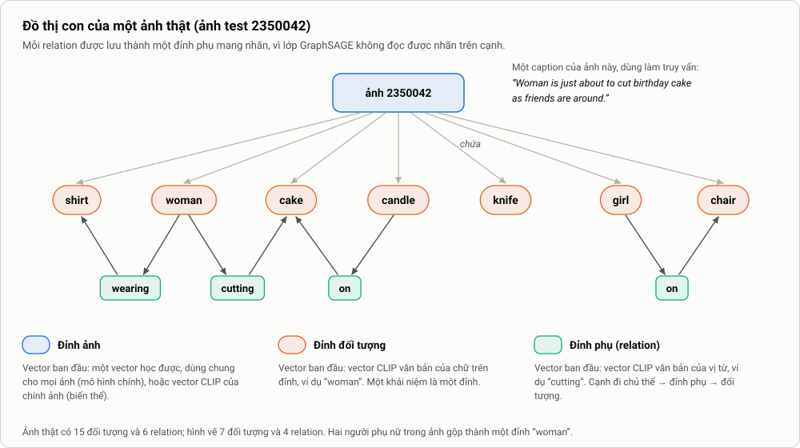
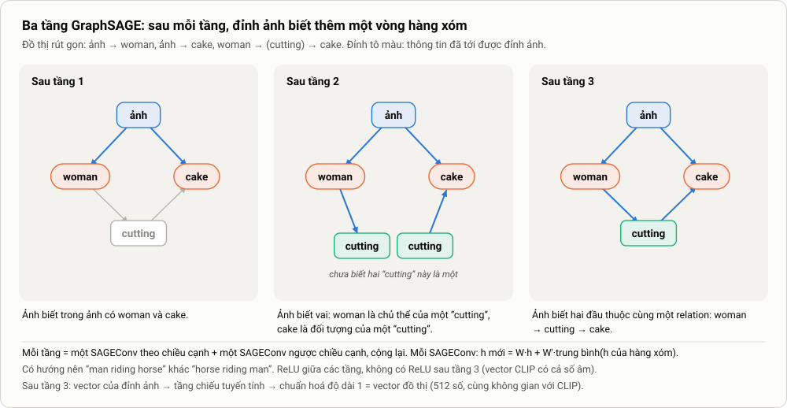
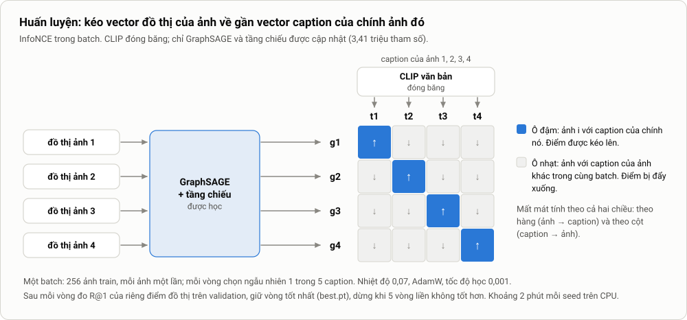
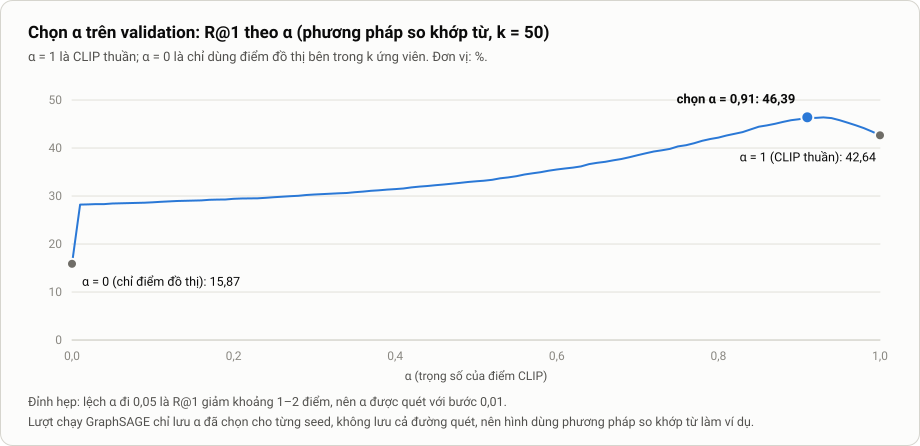
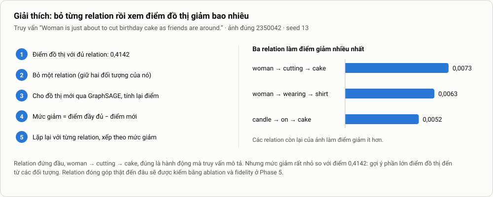

# 3. Mô hình: từ đồ thị cảnh đến điểm đồ thị

Trong dự án này, GraphSAGE là **bộ mã hoá biến một đồ thị thành một vector**. Nó không sinh đồ thị từ ảnh, vì đồ thị đã có sẵn từ Visual Genome (xem tài liệu 2). Việc của GraphSAGE là đọc đồ thị của một ảnh và trả về một vector 512 số, nằm trong cùng không gian với vector câu của CLIP.

## Đồ thị con của một ảnh

Mỗi ảnh là một đồ thị nhỏ, tách riêng khỏi các ảnh khác:



Đồ thị có ba loại đỉnh:

- **Đỉnh ảnh:** mỗi ảnh có một đỉnh, nối tới mọi đối tượng bằng cạnh "chứa".
- **Đỉnh đối tượng:** mỗi khái niệm có trong ảnh là một đỉnh.
- **Đỉnh phụ:** mỗi relation là một đỉnh, mang nhãn vị từ và đặt giữa chủ thể với đối tượng, ví dụ `woman → (cutting) → cake`.

Vì sao cần đỉnh phụ? Lớp GraphSAGE chỉ đọc được vector trên đỉnh, không đọc được nhãn trên cạnh. Nếu chỉ nối `woman — cake`, mô hình không phân biệt được "woman cutting cake" với "woman next to cake". Khi vị từ được đặt thành một đỉnh, nó có vector riêng và được đưa vào tính toán. Về ý nghĩa, relation vẫn là quan hệ giữa hai đối tượng; đỉnh phụ chỉ là cách lưu.

Các đồ thị con không nối với nhau, nên qua đồ thị, ảnh test không thể ảnh hưởng tới ảnh train.

**Vector ban đầu của từng loại đỉnh:**

| Đỉnh | Vector ban đầu |
|---|---|
| Đối tượng | Vector CLIP văn bản của chữ trên đỉnh, ví dụ "woman" |
| Đỉnh phụ | Vector CLIP văn bản của vị từ, ví dụ "cutting" |
| Ảnh, trong mô hình chính | Một vector học được, **dùng chung cho mọi ảnh**. Đỉnh ảnh không biết gì về điểm ảnh, nên vector đồ thị chỉ đến từ cấu trúc của đồ thị |
| Ảnh, trong biến thể | Vector CLIP của chính ảnh đó. Biến thể này thường cho số cao hơn, nhưng điểm đồ thị của nó đã lẫn thông tin CLIP của ảnh |

Mô hình chính dùng đỉnh ảnh chung để trả lời rõ ràng câu hỏi: phần cải thiện có thật sự đến từ đồ thị không?

## Ba tầng GraphSAGE

Ở mỗi tầng, mọi đỉnh lấy trung bình vector của các hàng xóm rồi trộn với vector của chính nó. Sau mỗi tầng, đỉnh ảnh "nhìn" xa thêm một bước:



- **Tầng 1:** ảnh biết mình có những vật gì.
- **Tầng 2:** ảnh biết vai của từng vật trong relation: `woman` là chủ thể của một `cutting`, còn `cake` là đối tượng của một `cutting`. Nếu ảnh chỉ có một relation `cutting` thì hai tầng là đủ.
- **Tầng 3:** ảnh biết hai đầu của cùng một relation đi với nhau. Tầng này cần thiết khi một ảnh có nhiều relation cùng vị từ. Ví dụ, "man riding bicycle, woman riding horse" phải cho vector khác với "man riding horse, woman riding bicycle". Với chỉ hai tầng, hai ảnh này cho cùng một vector; điều này được kiểm bằng test `test_two_layers_know_each_objects_role_and_three_layers_know_who_goes_with_whom`.

**Có hướng.** Nếu thông tin truyền qua cạnh theo cả hai chiều với cùng một bộ trọng số, "man riding horse" và "horse riding man" sẽ cho cùng một vector. Vì vậy mỗi tầng có hai lớp `SAGEConv` (lấy từ thư viện PyTorch Geometric): một lớp gom tin theo chiều cạnh, một lớp gom tin ngược chiều cạnh, rồi cộng kết quả lại. Config có cờ `directed: false` để tắt hướng khi làm ablation.

**Đầu ra.**

- Giữa các tầng có ReLU. Sau tầng cuối thì không, vì vector CLIP có cả số âm.
- Sau tầng 3, vector của đỉnh ảnh đi qua một tầng chiếu tuyến tính rồi được chuẩn hoá về độ dài 1. Kết quả là **vector đồ thị** của ảnh.
- Mô hình có 3,41 triệu tham số học được, với chiều ẩn 512.

## Huấn luyện



- **Batch.** Mỗi batch gồm 256 ảnh train. Mỗi ảnh có một vector đồ thị (do GraphSAGE tạo) và một vector caption (do CLIP tạo, từ 1 trong 5 caption được chọn ngẫu nhiên ở mỗi vòng).
- **Hàm mất mát.** Một bảng điểm 256 × 256 so mọi vector đồ thị với mọi vector caption. **InfoNCE** đẩy điểm của cặp đúng (trên đường chéo) lên cao hơn mọi cặp sai. Việc này làm theo cả hai chiều: từ ảnh tìm caption, và từ caption tìm ảnh.
- **Phần được học.** CLIP đóng băng. Chỉ GraphSAGE, tầng chiếu và vector dùng chung của đỉnh ảnh được cập nhật.
- **Dừng sớm.** Sau mỗi vòng, đo R@1 của riêng điểm đồ thị trên 1.500 ảnh validation. Vòng tốt nhất được lưu thành `best.pt`. Huấn luyện dừng khi 5 vòng liên tiếp không tốt hơn, tối đa 50 vòng.

| Tham số | Giá trị | Ghi chú |
|---|---|---|
| Số tầng, chiều ẩn | 3, 512 | |
| Batch | 256 | |
| Tốc độ học, weight decay | 0,001 và 0,0001 | AdamW |
| Nhiệt độ của InfoNCE | 0,07 | |
| Ngưỡng cắt gradient | 1,0 | |
| Dừng sớm | 5 vòng | Theo R@1 trên validation |
| Seed | 13, 37, 97 | |
| Thiết bị | CPU | Với các đồ thị nhỏ này, CPU nhanh hơn MPS. Khoảng 1–2,5 phút mỗi seed |

Đây là các giá trị khởi đầu, **chưa tinh chỉnh**.

Huấn luyện được thiết kế để chạy lại cho ra đúng kết quả cũ:

- Checkpoint `last.pt` được lưu sau mỗi vòng, ghi qua file tạm rồi mới đổi tên, nên bị ngắt giữa chừng cũng không hỏng file.
- Nếu bị ngắt, `--resume` chạy tiếp và cho đúng kết quả như khi chạy liền mạch.
- Nếu loss thành NaN, huấn luyện dừng trước khi cập nhật trọng số.
- Cùng một seed cho ra cùng một `history.json`.

## Chấm điểm và xếp hạng lại

Sau khi huấn luyện, vector đồ thị của cả 10.000 ảnh được tính một lần từ `best.pt` rồi lưu lại. Khi có truy vấn, hệ thống làm 4 bước:

1. CLIP mã hoá câu thành vector truy vấn.
2. Tính điểm CLIP = cosine(vector truy vấn, vector CLIP của ảnh) cho mọi ảnh trong gallery, rồi lấy top-k.
3. Tính điểm đồ thị = cosine(vector truy vấn, vector đồ thị) cho các ứng viên.
4. Tính điểm cuối = α · điểm CLIP + (1 − α) · điểm đồ thị. Ảnh ngoài top-k giữ thứ tự của CLIP và đứng dưới mọi ứng viên.

**Chọn α và k trên validation.**

- α được quét từ 0 đến 1 với bước 0,01; k được chọn trong {10, 20, 50, 100, 200, 500, 1.500}.
- Cấu hình tốt nhất là cấu hình có R@1 cao nhất. Nếu hoà thì xét MRR. Nếu vẫn hoà thì chọn cấu hình gần CLIP thuần nhất: α lớn nhất trước, rồi k nhỏ nhất. Nhờ luật này, một điểm đồ thị không thêm thông tin gì sẽ cho kết quả đúng bằng CLIP, chứ không bị báo nhầm là cải thiện.
- Khi chấm test, dùng đúng cấu hình đã chọn và chấm một lần.

Hình dưới cho thấy việc quét α trông như thế nào. Hình lấy ví dụ từ phương pháp so khớp từ, vì các lượt GraphSAGE chỉ lưu α đã chọn chứ không lưu cả đường quét:



- α = 1 cho đúng R@1 của CLIP: 42,64% trên validation.
- α = 0 (chỉ dùng điểm đồ thị trong 50 ứng viên) chỉ đạt 15,87%. Lý do là điểm so khớp từ có rất nhiều ảnh bằng điểm nhau, và luật hoà xếp ảnh đúng xuống dưới các ảnh bằng điểm. Chỉ cần thêm một chút CLIP (α = 0,01) để phá thế hoà là R@1 tăng lên 28,20%.
- Đỉnh nằm ở α = 0,91 và rất hẹp. Lưới bước 0,1 đã bỏ lỡ đỉnh này, chỉ đạt 46,04% thay vì 46,39%. Vì vậy bước quét được đặt là 0,01.

Một chi tiết kỹ thuật: điểm được tính bằng float64. Ảnh ngoài top-k được đẩy xuống bằng cách trừ đi một hằng số. Với float32, phép trừ này làm các điểm sát nhau trở thành bằng nhau, khiến thứ hạng thay đổi. Lỗi này được phát hiện nhờ phép kiểm "α = 1 phải cho đúng thứ hạng của CLIP".

## Giải thích một kết quả



Với mỗi ảnh trả về, hệ thống làm như sau:

1. Bỏ lần lượt từng relation, nhưng giữ lại hai đối tượng của nó.
2. Đưa đồ thị mới qua GraphSAGE và tính lại điểm đồ thị.
3. So với điểm ban đầu. Mức giảm càng lớn thì relation càng đóng góp nhiều vào điểm. Mức giảm âm nghĩa là relation đó đang kéo điểm xuống.

Lời giải thích được đo trên đúng mô hình đã chấm điểm, không phải một mô tả viết thêm sau đó. [Phụ lục B, mục B9](phu-luc-b-tinh-tay-tu-dau-den-cuoi.md#b9-giải-thích-bỏ-relation-rồi-tính-lại) tính tay một lần bỏ relation.

## Đo độ trung thực (fidelity) và ablation: code đã có, chưa có kết quả

Bốn commit mới nhất (của nghidt) thêm công cụ cho Phase 5. Mọi phần dưới đây đều đã có test, nhưng **chưa có file kết quả nào trong repo**.

**Đo fidelity** (`src/evaluation/fidelity.py`, chạy bằng `scripts/evaluate_fidelity.py`). Phép đo trả lời câu hỏi: các relation dùng để giải thích có thật sự quan trọng với điểm hơn các relation ngẫu nhiên không? Với mỗi truy vấn được lấy mẫu, công cụ xét ảnh đúng của truy vấn đó:

1. Tính mức giảm khi bỏ từng relation, rồi chọn tối đa `budget` relation có mức giảm dương lớn nhất. Đây là tập giải thích. Mặc định `budget` = 3, và không vượt quá một nửa số relation của ảnh.
2. Chọn ngẫu nhiên cùng số lượng relation trong phần còn lại làm nhóm đối chứng.
3. Bỏ **cùng lúc** từng nhóm, tính lại điểm đồ thị, rồi quy ra mức giảm của điểm cuối bằng cách nhân với (1 − α). Nếu ảnh không nằm trong top-k thì mức giảm bằng 0.
4. Ghi thêm *sparsity* = 1 − (số relation trong tập giải thích) / (tổng số relation).

Lời giải thích trung thực nếu bỏ tập giải thích làm điểm giảm rõ rệt hơn bỏ nhóm đối chứng. Công thức chi tiết và một ví dụ bằng số nằm ở [Phụ lục A, mục A16](phu-luc-a-kien-thuc-nen.md#a16-giải-thích-mô-hình-bỏ-từng-relation-fidelity-sparsity-validity). Công cụ dùng checkpoint và α, k đã chọn sẵn, không huấn luyện hay chọn lại gì. File kết quả của nó ghi rõ ba giới hạn: không đo thay đổi thứ hạng, không đánh giá validity, và ngân sách tối đa bằng một nửa số relation.

**Biến đổi đồ thị cho ablation** (`src/models/ablations.py`):

- `objects_only`: bỏ mọi relation, chỉ giữ ảnh và đối tượng. Đây là biến thể A2.
- `rewire_relations`: đảo đầu cạnh giữa các cặp relation, giữ nguyên số relation đi ra và đi vào của mỗi đối tượng cũng như số lần mỗi vị từ xuất hiện. Đây là biến thể A4 (xem ví dụ ở [Phụ lục A, mục A17](phu-luc-a-kien-thuc-nen.md#a17-ablation-và-đảo-cạnh-giữ-bậc)).
- `remove_relations`: bỏ các relation theo vị trí. Phép đo fidelity dùng hàm này.

Chưa có script nào huấn luyện hoặc chấm điểm trên các đồ thị đã biến đổi. Biến thể A3 (bỏ vị từ) và A7 (xử lý hub) chưa có code. Biến thể tắt hướng dùng cờ `graphsage.directed: false` có sẵn trong config.

## Phương pháp để so sánh: so khớp từ (B4)

Để biết GraphSAGE có thật sự cần thiết không, dự án có một cách chấm điểm đồ thị không dùng mạng nơ-ron:

```
điểm so khớp từ = tổng IDF của các từ trong caption có xuất hiện trong chữ của đồ thị ảnh
                  ÷ tổng IDF của mọi từ nội dung trong caption
```

- IDF cho từ hiếm trọng số cao và cho từ phổ biến (như `man`, `on`) trọng số thấp. IDF chỉ được tính trên đồ thị của ảnh train.
- Có hai biến thể: dùng cả khái niệm lẫn vị từ (`graph_lexical`), hoặc chỉ dùng khái niệm (`graph_lexical_objects`).
- Giới hạn đã biết: hàm bỏ đuôi số nhiều còn thô sơ (`glasses` không khớp với `glass`, `men` không khớp với `man`), nên B4 bị đánh giá hơi thấp hơn thực tế.
- [Phụ lục A, mục A6](phu-luc-a-kien-thuc-nen.md#a6-idf-và-điểm-so-khớp-từ-b4) tính điểm này bằng số thật cho truy vấn ví dụ. Kết quả cho thấy vì sao so khớp từ có thể xếp nhầm: "cut" không khớp được với "cutting", trong khi chữ "birthday" ở một ảnh sai lại khớp.

GraphSAGE phải hơn cả B4 chứ không chỉ hơn CLIP. Kết quả ở [tài liệu 4](04-ket-qua.md).
