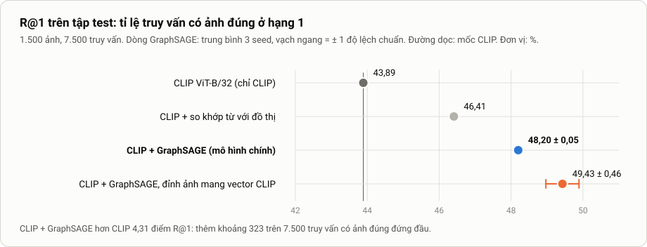
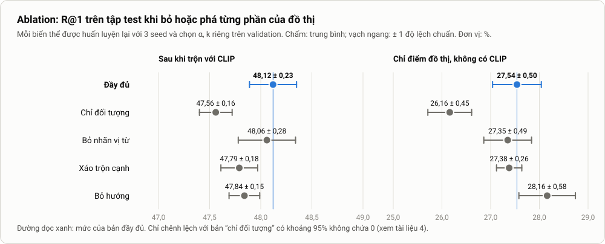
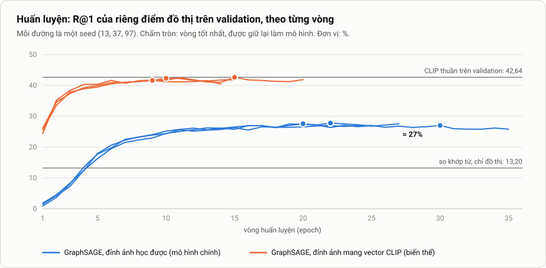

# 4. Kết quả hiện có (cập nhật 18/11/2026)

## Hai lượt chạy của mô hình chính

Mô hình chính (CLIP + GraphSAGE, đỉnh ảnh học được) đã được huấn luyện hai lần, cả hai đều với 3 seed 13, 37, 97:

| Lượt | Ngày | R@1 test | Ở đâu |
|---|---|---|---|
| Lượt đầu | 17/11 | 48,20 ± 0,05 | Bảng trong `README.md` gốc và lịch sử Git |
| Lượt chạy lại | 18/11 | 48,12 ± 0,23 | Các file hiện có trong `runs/` |

Lượt 18/11 được chạy sau khi tải lại 10.000 ảnh và tạo lại vector CLIP. Lượt này dùng cùng thiết lập với lượt đầu và chạy chung với 4 biến thể ablation. Hai lượt không giống nhau từng byte, nhưng cho kết quả rất gần nhau.

**Tài liệu này lấy lượt 18/11 làm số chính**, vì các file hiện có trong repo, các biểu đồ và ablation đều dựa trên lượt này. Số của lượt 17/11 được giữ lại để đối chiếu. Biến thể "đỉnh ảnh mang vector CLIP" và ví dụ giải thích ở cuối tài liệu là của lượt 17/11.

## Tóm tắt

- **CLIP + GraphSAGE đạt R@1 khoảng 48,1–48,2%** trên tập test (48,12 ± 0,23 ở lượt 18/11; 48,20 ± 0,05 ở lượt 17/11). CLIP thuần đạt 43,89%. Mức tăng 4,2–4,3 điểm tương ứng khoảng 320 trong 7.500 truy vấn có thêm ảnh đúng ở hạng 1.
- Mô hình chính hơn cách so khớp từ với đồ thị (46,41) khoảng **1,7–1,8 điểm** R@1.
- **Riêng điểm đồ thị**, không có CLIP và không thấy điểm ảnh nào, vẫn đặt đúng ảnh ở hạng 1 cho khoảng **27,5%** truy vấn. Mức ngẫu nhiên chỉ là 0,07%.
- **Ablation:**
  - Bỏ hết relation làm R@1 giảm 0,56 điểm, với khoảng 95% là [0,05; 1,06]. Như vậy relation có đóng góp, nhưng nhỏ: bản chỉ có đối tượng vẫn giữ được khoảng 87% phần tăng so với CLIP.
  - Bỏ nhãn vị từ, xáo trộn cạnh hay bỏ hướng đều **chưa cho khác biệt rõ ràng**.
- **Kiểm tra lời giải thích:**
  - Xoá nhóm relation được chọn làm giải thích khiến ảnh đứng đầu mất vị trí ở 17,81% truy vấn, so với 4,31% khi xoá ngẫu nhiên cùng số relation (mức xoá yêu cầu 10%).
  - Validity mới có nhãn sơ bộ do AI gán; còn chờ người chấm.

## Cách đo

- Tập test có 1.500 ảnh và 7.500 truy vấn; mỗi truy vấn có đúng một ảnh đúng.
- Mọi phương pháp dùng chung split, gallery và tập ứng viên của cùng một CLIP.
- α và k được chọn trên validation, riêng cho từng seed và từng biến thể. Test chỉ được chấm sau khi đã chốt các giá trị này.
- Với phương pháp có huấn luyện, báo cáo trung bình ± độ lệch chuẩn mẫu qua 3 seed. Phương pháp không có yếu tố ngẫu nhiên (CLIP, so khớp từ) chỉ cần chạy một lần.
- So sánh giữa các biến thể ablation dùng thêm **bootstrap ghép cặp theo cụm** (xem [Phụ lục A, mục A19](phu-luc-a-kien-thuc-nen.md#a19-bootstrap-theo-cụm-và-khoảng-95)). Kết quả là khoảng 95% cho chênh lệch R@1, tính trên chính 3 mô hình đã huấn luyện.

## Bảng chính: CLIP so với CLIP + đồ thị (test, %)

| Phương pháp | R@1 | R@5 | R@10 | MRR |
|---|---|---|---|---|
| CLIP ViT-B/32 | 43,89 | 72,19 | 82,64 | 56,76 |
| CLIP + so khớp từ (khái niệm + vị từ) | 46,41 | 74,80 | 85,41 | 59,29 |
| CLIP + so khớp từ (chỉ khái niệm) | 46,53 | 74,81 | 85,33 | 59,32 |
| **CLIP + GraphSAGE, lượt 18/11** | **48,12 ± 0,23** | **75,33 ± 0,65** | 83,87 ± 2,12 | **60,41 ± 0,44** |
| CLIP + GraphSAGE, lượt 17/11 | 48,20 ± 0,05 | 75,87 ± 0,18 | 86,39 ± 0,14 | 60,75 ± 0,10 |
| CLIP + GraphSAGE, đỉnh ảnh mang vector CLIP (17/11) | 49,43 ± 0,46 | 77,90 ± 0,47 | 87,52 ± 0,69 | 62,22 ± 0,37 |

Biểu đồ dùng các file hiện có trong `runs/`: mô hình chính là lượt 18/11, còn biến thể mang vector CLIP là lượt 17/11.

**Cách đọc:**

- **Hai lượt cho kết quả rất gần nhau.** R@1 của hai lượt chỉ chênh 0,08 điểm, nhỏ hơn độ lệch giữa các seed của lượt 18/11 (0,23). Mức tăng so với CLIP lặp lại được.
- **R@10 của lượt 18/11 dao động mạnh (± 2,12) vì cách chọn k.**
  - Ở lượt này, hai seed chọn k = 10 trên validation. Khi chỉ xếp lại trong 10 ứng viên đầu của CLIP, tập 10 ảnh đầu không thay đổi, nên R@10 của hai seed đó bằng đúng R@10 của CLIP (82,64).
  - Đây là hệ quả của việc chọn k, không phải dấu hiệu bộ mã hoá đồ thị kém đi.
  - Lượt 17/11 chọn k = 500 hoặc 1.500 nên không gặp hiện tượng này.
- **So khớp từ đã là một mốc khá cao.** Riêng nó đã giúp CLIP tăng 2,5 điểm R@1, nên mốc mà GraphSAGE phải vượt là 46,41, không chỉ 43,89. Bản có vị từ (46,41) cũng không hơn bản chỉ dùng khái niệm (46,53).
- **Biến thể mang vector CLIP không được chọn làm mô hình chính.** Nó cao hơn khoảng 1,2–1,3 điểm, nhưng điểm đồ thị của nó đã chứa thông tin CLIP của ảnh, nên không tách được phần đóng góp riêng của đồ thị.

## Riêng điểm đồ thị, không có CLIP (test, %)

| Phương pháp | R@1 | R@5 | R@10 | MRR |
|---|---|---|---|---|
| Chọn ngẫu nhiên | 0,07 | 0,33 | 0,67 | 0,53 |
| So khớp từ (khái niệm + vị từ) | 12,63 | 29,35 | 39,93 | 21,59 |
| So khớp từ (chỉ khái niệm) | 10,96 | 27,15 | 37,91 | 19,87 |
| **GraphSAGE, lượt 18/11** | **27,54 ± 0,50** | **57,44 ± 0,83** | **72,23 ± 0,40** | **41,61 ± 0,32** |
| GraphSAGE, lượt 17/11 | 27,78 ± 0,63 | 57,40 ± 0,45 | 72,20 ± 0,36 | 41,71 ± 0,49 |
| GraphSAGE, đỉnh ảnh mang vector CLIP (17/11) | 42,25 ± 0,48 | 73,79 ± 0,16 | 84,73 ± 0,24 | 56,39 ± 0,31 |
| *CLIP thuần, để so sánh* | *43,89* | *72,19* | *82,64* | *56,76* |

**Cách đọc:**

- **Đồ thị một mình đã tìm được ảnh khá tốt.** Mô hình chính chỉ thấy *nhãn* của đồ thị (đối tượng, vị từ, cấu trúc), không thấy ảnh. Dù vậy, trong 1.500 ảnh, nó đặt đúng ảnh ở hạng 1 cho khoảng 27,5% truy vấn, gấp 2,2 lần so khớp từ và hơn 400 lần mức ngẫu nhiên.
- **Con số của biến thể không đo giá trị của đồ thị.** Biến thể mang vector CLIP đạt 42,25%, gần bằng CLIP thuần, vì đỉnh ảnh của nó đã chứa sẵn vector CLIP của ảnh.

## Ablation: phần cải thiện đến từ đâu (lượt 18/11)

Mỗi biến thể bỏ hoặc phá một thành phần của đồ thị, rồi được huấn luyện lại từ đầu với cùng dữ liệu, cùng seed và cùng cách chọn α, k. Định nghĩa chi tiết nằm ở [tài liệu 3](03-mo-hinh.md#ablation-và-kiểm-tra-lời-giải-thích).

| Biến thể | Thay đổi | R@1 | R@5 | R@10 | MRR | R@1 chỉ đồ thị |
|---|---|---|---|---|---|---|
| **Đầy đủ** | — | **48,12 ± 0,23** | 75,33 ± 0,65 | 83,87 ± 2,12 | 60,41 ± 0,44 | 27,54 ± 0,50 |
| Chỉ đối tượng | Bỏ mọi relation | 47,56 ± 0,16 | 75,65 ± 0,12 | 85,65 ± 0,07 | 60,25 ± 0,15 | 26,16 ± 0,45 |
| Bỏ nhãn vị từ | Vector của đỉnh phụ bằng 0 | 48,06 ± 0,28 | 76,06 ± 0,12 | 86,28 ± 0,13 | 60,67 ± 0,23 | 27,35 ± 0,49 |
| Cạnh ngẫu nhiên | Xáo trộn chủ thể và đối tượng | 47,79 ± 0,18 | 75,26 ± 0,22 | 83,87 ± 2,12 | 60,09 ± 0,24 | 27,38 ± 0,26 |
| Bỏ hướng | Một SAGEConv trên cạnh hai chiều | 47,84 ± 0,15 | 76,04 ± 0,16 | 86,24 ± 0,21 | 60,58 ± 0,10 | 28,16 ± 0,58 |

**Chênh lệch R@1 (sau khi trộn) giữa bản đầy đủ và từng biến thể**, kèm khoảng 95% của bootstrap ghép cặp:

| So với | Chênh lệch | Khoảng 95% | Kết luận |
|---|---|---|---|
| Chỉ đối tượng | +0,56 | [0,05; 1,06] | Relation có đóng góp; khoảng không chứa 0, nhưng cận dưới sát 0 |
| Bỏ nhãn vị từ | +0,05 | [−0,35; 0,45] | Chưa thấy nhãn vị từ có ích |
| Cạnh ngẫu nhiên | +0,33 | [−0,09; 0,74] | Chưa đủ chắc để nói cấu trúc thật tốt hơn cấu trúc ngẫu nhiên |
| Bỏ hướng | +0,28 | (tài liệu nhóm chưa ghi) | Chưa kết luận được, vì bản bỏ hướng có ít tham số hơn |

**Cách đọc:**

- **Phần lớn mức tăng đến từ danh sách đối tượng.** Bản chỉ có đối tượng vẫn tăng 3,67 điểm so với CLIP (47,56 − 43,89), tức khoảng 87% của mức tăng 4,23 điểm của bản đầy đủ. Relation góp phần còn lại, khoảng 0,56 điểm.
- **Nhãn vị từ gần như không đóng góp.** Bỏ hẳn vector của vị từ chỉ làm R@1 giảm 0,05 điểm. Ở phép đo riêng điểm đồ thị, mức giảm cũng không đáng kể (27,35 so với 27,54).
- **Hướng của relation chưa chứng minh được giá trị.** Bản bỏ hướng có điểm đồ thị riêng còn cao hơn bản đầy đủ (28,16 so với 27,54). Tuy nhiên bản này ít tham số hơn, nên chưa tách được ảnh hưởng của hướng với ảnh hưởng của kích thước mô hình.
- **R@10 của "đầy đủ" và "cạnh ngẫu nhiên" thấp hơn các dòng khác.** Lý do giống ở bảng chính: một số seed chọn k = 10, nên R@10 bằng của CLIP. Đây không phải dấu hiệu mô hình kém.
- **Khoảng 95% có điều kiện.** Khoảng được tính trên chính 3 mô hình đã huấn luyện, chưa phản ánh mọi seed có thể có, và chưa hiệu chỉnh cho việc so sánh nhiều lần.

## Kiểm tra lời giải thích: fidelity, sparsity, validity

Các phép đo dưới đây dùng 3 checkpoint của lượt 18/11 và không huấn luyện lại hay chọn lại tham số gì. Tổng cộng có 200 truy vấn test được lấy mẫu cố định. Cách tính chi tiết nằm ở [tài liệu 3](03-mo-hinh.md#ablation-và-kiểm-tra-lời-giải-thích) và [Phụ lục A, mục A16](phu-luc-a-kien-thuc-nen.md#a16-giải-thích-mô-hình-bỏ-từng-relation-fidelity-sparsity-validity).

**Fidelity: xoá đồng thời nhóm giải thích, so với xoá ngẫu nhiên.** Số truy vấn đánh giá được lần lượt là 198, 195 và 196 trên 200 cho ba seed; những truy vấn còn lại bị bỏ vì ảnh có ít hơn 3 relation. Các số dưới đây là trung bình qua ba mô hình:

| Mức xoá yêu cầu | Ảnh đứng đầu mất vị trí: nhóm giải thích | Ảnh đứng đầu mất vị trí: nhóm ngẫu nhiên | Điểm đồ thị giảm: nhóm giải thích | Điểm đồ thị giảm: nhóm ngẫu nhiên |
|---|---|---|---|---|
| 10% số relation | 17,81% | 4,31% | 0,02200 | 0,00142 |
| 25% số relation | 25,45% | 6,06% | 0,03040 | 0,00216 |

- So với xoá ngẫu nhiên cùng số relation, xoá các relation được chọn làm giải thích có tác động **gấp khoảng 4 lần** về tỉ lệ mất hạng 1, và **gấp 14–15 lần** về mức giảm điểm đồ thị.
- Giới hạn: nhóm giải thích được chọn bằng chính phép xoá từng relation. Vì vậy phép xoá nhóm là bằng chứng bổ sung chứ không độc lập. Đây là kiểm tra bằng can thiệp, không chứng minh lời giải thích đúng về ngữ nghĩa.

**Sparsity và keep-only.** Trung bình qua ba seed:

| Mức xoá yêu cầu | Tỉ lệ relation thực tế trong giải thích | Sparsity | Chỉ giữ nhóm giải thích: ảnh vẫn đứng đầu | Chỉ giữ nhóm ngẫu nhiên: ảnh vẫn đứng đầu |
|---|---|---|---|---|
| 10% | 20,24% | 79,76% | 94,23% | 81,52% |
| 25% | 30,17% | 69,83% | 98,81% | 85,82% |

- Tỉ lệ thực tế cao hơn mức yêu cầu vì mỗi lời giải thích có ít nhất 2 relation.
- Chỉ giữ lại khoảng 1/5 số relation, đúng là các relation giải thích, đủ để giữ ảnh ở hạng 1 trong 94% trường hợp.
- Hạng 1 ở đây là dự đoán ban đầu, có thể sai, và CLIP vẫn còn nguyên. Vì vậy các tỉ lệ này không phải độ chính xác.

**Validity (lượt thử, nhãn do AI gán).**

- Mẫu gồm 20 truy vấn của checkpoint seed 13, cân bằng 10 truy vấn có ảnh đứng đầu đúng và 10 truy vấn có ảnh đứng đầu sai, tổng cộng 42 relation được chấm.
- **Đúng với ảnh:** 29 có, 2 không, 11 chưa rõ.
- **Liên quan tới truy vấn:** 20 relation.
- **Đạt cả hai tiêu chí:** 17 relation, tức 40,48%; nếu tính cả 2 ca chưa rõ là đạt thì 45,24%.
- Đây là nhãn sơ bộ của một trợ lý AI, chưa phải đồng thuận của người chấm. Form để người chấm nằm ở `tools/validity-review/index.html`.

## Huấn luyện

Biểu đồ dùng lịch sử huấn luyện hiện có trong `runs/`: mô hình chính là lượt 18/11, biến thể mang vector CLIP là lượt 17/11.

| Biến thể | Seed | Vòng tốt nhất / số vòng đã chạy | R@1 val (chỉ đồ thị) | MRR val | Thời gian |
|---|---|---|---|---|---|
| Đỉnh ảnh học được (18/11) | 13 | 21 / 26 | 27,41 | 41,64 | 186 s |
| | 37 | 26 / 31 | 27,59 | 41,54 | 220 s |
| | 97 | 21 / 26 | 27,17 | 41,09 | 181 s |
| Đỉnh ảnh mang vector CLIP (17/11) | 13 | 15 / 20 | 42,64 | 56,43 | 89 s |
| | 37 | 10 / 15 | 42,33 | 56,02 | 59 s |
| | 97 | 9 / 14 | 41,59 | 55,50 | 55 s |

**Cách đọc:**

- **Không lượt nào chạm giới hạn 50 vòng.** Mọi lượt đều dừng vì validation không còn cải thiện trong 5 vòng liền.
- **Hai biến thể học khác nhau.**
  - Mô hình chính bắt đầu ở khoảng 1%, vì đỉnh ảnh chưa biết gì, rồi chững lại quanh 27%.
  - Biến thể mang vector CLIP đạt khoảng 25% ngay từ vòng 1 và chững quanh 42%, gần mức của CLIP thuần trên validation (42,64%).
- **Dừng sớm cắt đúng lúc.** Với seed 13, loss train giảm đều từ 4,98 xuống 1,54. Loss validation từ vòng 10 trở đi đi ngang trong khoảng 1,98–2,14: mô hình bắt đầu quá khớp nhẹ, và dừng sớm đã chặn đúng lúc đó.
- **Ba seed gần như trùng nhau**, nên kết quả không phụ thuộc may rủi của khởi tạo.

## α và k được chọn

| Lượt | Seed | α | k | R@1 val (sau xếp lại) | R@1 test (sau xếp lại) |
|---|---|---|---|---|---|
| So khớp từ (khái niệm + vị từ) | — | 0,91 | 50 | 46,39 | 46,41 |
| So khớp từ (chỉ khái niệm) | — | 0,90 | 500 | 46,28 | 46,53 |
| GraphSAGE, lượt 18/11 | 13 | 0,78 | 500 | 47,11 | 48,36 |
| | 37 | 0,84 | 10 | 46,24 | 48,08 |
| | 97 | 0,78 | 10 | 46,63 | 47,91 |
| GraphSAGE, lượt 17/11 | 13 | 0,81 | 1.500 | 46,95 | 48,24 |
| | 37 | 0,83 | 1.500 | 46,28 | 48,20 |
| | 97 | 0,78 | 500 | 46,68 | 48,15 |
| GraphSAGE, đỉnh ảnh mang vector CLIP (17/11) | 13 | 0,66 | 500 | 48,92 | 48,99 |
| | 37 | 0,63 | 500 | 48,64 | 49,91 |
| | 97 | 0,68 | 20 | 48,49 | 49,39 |

**Cách đọc:**

- **α cho thấy hệ thống tin bên nào hơn.** Mô hình chính chọn α khoảng 0,8 ở cả hai lượt: CLIP vẫn là phần chính, còn đồ thị dùng để chỉnh. Biến thể mang vector CLIP chọn α khoảng 0,65, tức tin điểm đồ thị hơn, vì điểm đồ thị của nó mạnh hơn.
- **k thay đổi nhiều giữa các lượt nhưng R@1 thì không.** k được chọn khác hẳn giữa hai lượt (10 so với 1.500), trong khi R@1 gần như không đổi. R@1 ít nhạy với k: ở đường quét của so khớp từ, R@1 tốt nhất chỉ dao động trong khoảng 46,25–46,39 khi k đi từ 10 tới 1.500.
- **Validation và test cùng xu hướng.** Trên validation, CLIP + GraphSAGE đạt 46,66 ± 0,43 (lượt 18/11) so với 42,64 của CLIP.

## Một ví dụ có giải thích (lượt 17/11)

Truy vấn test `coco-659101`: *"Woman is just about to cut birthday cake as friends are around."* Dùng checkpoint seed 13 của lượt 17/11, với α = 0,81 và k = 1.500.

| Hạng | Ảnh | Điểm CLIP | Điểm đồ thị | Điểm cuối | 3 relation đóng góp nhiều nhất (mức giảm khi bỏ) |
|---|---|---|---|---|---|
| 1 ✓ | 2350042 | 0,3242 | 0,4142 | 0,3413 | woman → cutting → cake (0,0073); woman → wearing → shirt (0,0063); candle → on → cake (0,0052) |
| 2 | 2363149 | 0,3154 | 0,4329 | 0,3378 | woman → with → hair (0,0050); woman → wearing → glasses (0,0027); person → at → table (0,0020) |
| 3 | 2354907 | 0,3074 | 0,4013 | 0,3253 | lady → has → hair (0,0055); slice → part of → cake (0,0037); candle → behind → cake (0,0026) |

Kiểm tay dòng 1: 0,81 × 0,3242 + 0,19 × 0,4142 = 0,2626 + 0,0787 = 0,3413.

**Cách đọc:**

- **Lời giải thích khớp với truy vấn.** Ảnh đúng đứng hạng 1 cả trước và sau khi xếp lại. Relation giải thích đứng đầu, `woman → cutting → cake`, đúng là hành động mà truy vấn mô tả.
- **Điểm đồ thị không phải lúc nào cũng đúng.** Ảnh hạng 2 có điểm đồ thị cao hơn ảnh đúng (0,4329 so với 0,4142). Ảnh đúng vẫn giữ hạng 1 nhờ điểm CLIP cao hơn.
- **Bỏ một relation chỉ làm điểm giảm rất ít**, dưới 0,01 trên mức điểm khoảng 0,41. Điều này khớp với ablation: phần lớn điểm đồ thị đến từ các đối tượng.

File gồm 4 truy vấn mẫu: `runs/explanations/directed-learned-l3-h512-seed13.json`. Theo `task.md`, phần phân tích 5 truy vấn thành công và 5 truy vấn thất bại đã làm xong nhưng chưa được commit.

## Đọc kết quả cho đúng: điều đã và chưa chứng minh

| Câu hỏi | Trạng thái |
|---|---|
| CLIP + GraphSAGE có hơn CLIP trên cùng tập ứng viên không? | **Có**: +4,2 đến 4,3 điểm R@1 trên test, lặp lại được ở hai lượt chạy |
| Có hơn cách dùng đồ thị đơn giản (so khớp từ) không? | **Có**: +1,7 đến 1,8 điểm R@1 |
| Có tham số nào được chọn trên test không? | **Không**. Hàm quét α, k từ chối mọi tập khác validation |
| Phần tăng đến từ *quan hệ* hay chỉ từ *danh sách đối tượng*? | **Phần lớn từ đối tượng.** Relation góp khoảng 0,56 điểm, với khoảng 95% [0,05; 1,06]. Nhãn vị từ, cấu trúc thật và hướng chưa cho lợi thế rõ |
| Lời giải thích có ảnh hưởng thật tới dự đoán không (fidelity)? | **Có, theo phép can thiệp.** Xoá nhóm giải thích làm mất hạng 1 ở 17,81% truy vấn, so với 4,31% khi xoá ngẫu nhiên. Nhưng phép đo này không độc lập với cách chọn giải thích |
| Lời giải thích có hợp lý với người xem không (validity)? | **Chưa kết luận.** Mới có nhãn sơ bộ do AI gán: 40–45% relation đạt cả hai tiêu chí |
| Kết quả có giữ được khi đổi backbone (OpenCLIP) hoặc đổi tập dữ liệu không? | **Chưa chạy** |
| Tham số huấn luyện đã được tối ưu chưa? | **Chưa**. Vẫn là giá trị khởi đầu |

Giới hạn đã biết:

- **Cần đồ thị có sẵn.** Mọi ảnh phải có đồ thị cảnh do người gán. Ảnh ngoài Visual Genome cần một mô hình sinh đồ thị cảnh, mà dự án chưa có.
- **Đồ thị thiếu thuộc tính.** Đồ thị gần như không có màu sắc, kích thước hay khung cảnh. Một số relation khó hiểu hoặc có thể là nhãn nhiễu, ví dụ `skateboard has arm`.
- **Từ gần nghĩa chưa được gộp.** Ví dụ `guy` và `man` vẫn là hai đỉnh khác nhau.
- **Ablation bỏ hướng chưa công bằng về số tham số**, và chưa có ablation xử lý hub.
- **Số tuyệt đối không so trực tiếp được với các bài báo.** Gallery 1.500 ảnh nhỏ hơn bộ chuẩn COCO 5K. CLIP ViT-B/32 zero-shot trên COCO 5K (từ văn bản tìm ảnh) được công bố đạt R@1 30,4 (bảng 9, arXiv 2210.08402). Gallery ở đây nhỏ hơn 3,3 lần, nên số cao hơn là hợp lý.

## Việc tiếp theo

Theo `task.md` và `plan-task/requirements-checklist.md`:

| Việc | Trạng thái |
|---|---|
| Phân tích 5 truy vấn thành công và 5 truy vấn thất bại | Đã làm, chưa commit |
| Validity: thu nhãn của người chấm và đối chiếu với nhãn AI | Đang làm |
| Tập dữ liệu công khai thứ hai | Đang tìm hiểu, chưa có người nhận |
| Bộ 20 truy vấn, tách nhóm trực tiếp và gián tiếp | Chưa có người nhận |
| Thuật toán mới (từ 2024 trở đi): tái hiện AdaMF-MAT | Đang làm, trên branch `feat/reproduce-adamf-mat`, chưa merge vào `main` |
| Mô hình trên đồ thị dị thể (R-GCN hoặc HGT) | Chưa làm |
| MMKG tiếng Việt (xem `docs/build_MMKG.md`) | Đang làm |
| Ablation xử lý hub; ablation bỏ hướng với số tham số khớp bản đầy đủ | Chưa làm |
| Backbone thứ hai (OpenCLIP) | Chưa làm |
| Text-to-video; demo | Chưa có người nhận |
| Báo cáo | Đang làm |

## Số liệu lấy từ đâu

| Nội dung | File |
|---|---|
| CLIP và so khớp từ | `runs/benchmark/clip.json`, `graph_lexical.json`, `graph_lexical_objects.json` (có cả đường quét α, k trên validation) |
| GraphSAGE, lượt hiện tại | `runs/benchmark/graphsage-directed-learned-l3-h512.json` (lượt 18/11) |
| Biến thể mang vector CLIP | `runs/benchmark/graphsage-directed-clip_image-l3-h512.json` (lượt 17/11) |
| Ablation | `runs/benchmark/graphsage-directed-learned-l3-h512-<biến thể>-a0.json` và `runs/graphsage/<lượt chạy>/seed<n>/` |
| Lượt 17/11 của mô hình chính | Bảng trong `README.md` gốc và lịch sử Git của các file trên |
| Khoảng 95%, fidelity, sparsity, validity | Các file kết quả nằm ở `runs/analysis/`, `runs/fidelity/`, `runs/explanation-quality/` trên máy đã chạy; chúng không được commit. Các con số được nhóm ghi lại ở mục "Observed evidence" của `docs/graphsage-design-decisions.md` |
| Giải thích | `runs/explanations/directed-learned-l3-h512-seed13.json` (lượt 17/11) |

Tiếp theo: [5. Chạy lại và bản đồ code](05-chay-lai-va-ban-do-code.md).
