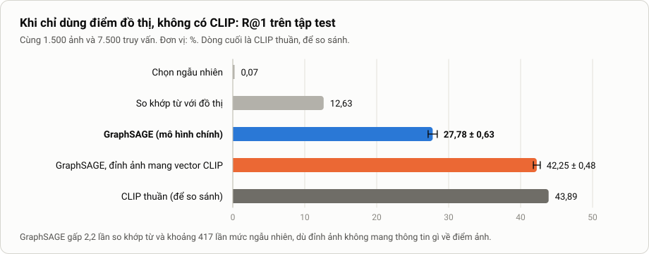

# 4. Kết quả hiện có (cập nhật 18/11/2026)

Các lượt chạy có kết quả đều hoàn thành ngày 17/11/2026. Từ đó tới nay, repo có thêm code đo fidelity và code ablation nhưng chưa có kết quả mới. Mục [Đọc kết quả cho đúng](#đọc-kết-quả-cho-đúng-điều-đã-và-chưa-chứng-minh) ghi rõ những gì còn thiếu.

## Tóm tắt

- **CLIP + GraphSAGE đạt R@1 48,20 ± 0,05** trên tập test, trong khi CLIP thuần đạt 43,89. Mức tăng là 4,31 điểm, tức trong 7.500 truy vấn có thêm khoảng 320 truy vấn có ảnh đúng ở hạng 1.
- Mô hình chính cũng hơn **1,79 điểm** so với cách so khớp từ với đồ thị (46,41), là cách không dùng mạng nơ-ron. Mô hình chính hơn cả CLIP lẫn so khớp từ ở cả 4 chỉ số.
- Khi dùng **riêng điểm đồ thị**, không có CLIP và không nhìn thấy điểm ảnh nào, mô hình vẫn đặt đúng ảnh ở hạng 1 cho **27,78%** truy vấn. Con số này gấp 2,2 lần so khớp từ và hơn 400 lần mức ngẫu nhiên.
- 3 seed cho kết quả rất sát nhau. Số trên validation và trên test cùng xu hướng, nên việc chọn α, k trên validation không bị quá khớp với validation.
- **Chưa chứng minh được** phần cải thiện đến từ *quan hệ* chứ không chỉ từ *danh sách đối tượng*. Việc này cần ablation (Phase 5).

## Cách đo

- Tập test có 1.500 ảnh và 7.500 truy vấn; mỗi truy vấn có đúng một ảnh đúng.
- Mọi phương pháp dùng chung split, gallery và tập ứng viên của cùng một CLIP.
- α và k được chọn trên validation, riêng cho từng seed. Test chỉ được chấm một lần, sau khi đã chốt các giá trị này.
- Với phương pháp có huấn luyện, báo cáo trung bình ± độ lệch chuẩn mẫu qua 3 seed (13, 37, 97). Phương pháp không có yếu tố ngẫu nhiên (CLIP, so khớp từ) chỉ cần chạy một lần; không giả lập thêm seed.

## Bảng chính: CLIP so với CLIP + đồ thị (test, %)

| Phương pháp | R@1 | R@5 | R@10 | MRR |
|---|---|---|---|---|
| CLIP ViT-B/32 | 43,89 | 72,19 | 82,64 | 56,76 |
| CLIP + so khớp từ (khái niệm + vị từ) | 46,41 | 74,80 | 85,41 | 59,29 |
| CLIP + so khớp từ (chỉ khái niệm) | 46,53 | 74,81 | 85,33 | 59,32 |
| **CLIP + GraphSAGE (mô hình chính)** | **48,20 ± 0,05** | **75,87 ± 0,18** | **86,39 ± 0,14** | **60,75 ± 0,10** |
| CLIP + GraphSAGE, đỉnh ảnh mang vector CLIP | 49,43 ± 0,46 | 77,90 ± 0,47 | 87,52 ± 0,69 | 62,22 ± 0,37 |

**Cách đọc:**

- **So khớp từ đã là một mốc khá cao.** Riêng nó đã giúp CLIP tăng 2,5 điểm R@1. Vì vậy mốc mà GraphSAGE phải vượt là 46,41 chứ không chỉ là 43,89, và GraphSAGE vượt mốc này 1,79 điểm.
- **Thêm vị từ không giúp so khớp từ.** Khi ghép với CLIP, bản có vị từ (46,41) không hơn bản chỉ dùng khái niệm (46,53). So khớp từng chữ không phân biệt được "man riding bike" với trường hợp "man" và "bike" đứng riêng.
- **Biến thể đỉnh ảnh mang vector CLIP cao hơn nhưng không được chọn làm mô hình chính.** Nó cao hơn 1,2 điểm R@1, nhưng dao động giữa các seed lớn hơn gần 10 lần (0,46 so với 0,05). Quan trọng hơn, điểm đồ thị của biến thể đã chứa thông tin CLIP của ảnh, nên không tách được phần đóng góp riêng của đồ thị. Vì vậy mô hình chính là bản có đỉnh ảnh học được.

## Riêng điểm đồ thị, không có CLIP (test, %)

| Phương pháp | R@1 | R@5 | R@10 | MRR |
|---|---|---|---|---|
| Chọn ngẫu nhiên | 0,07 | 0,33 | 0,67 | 0,53 |
| So khớp từ (khái niệm + vị từ) | 12,63 | 29,35 | 39,93 | 21,59 |
| So khớp từ (chỉ khái niệm) | 10,96 | 27,15 | 37,91 | 19,87 |
| **GraphSAGE (mô hình chính)** | **27,78 ± 0,63** | **57,40 ± 0,45** | **72,20 ± 0,36** | **41,71 ± 0,49** |
| GraphSAGE, đỉnh ảnh mang vector CLIP | 42,25 ± 0,48 | 73,79 ± 0,16 | 84,73 ± 0,24 | 56,39 ± 0,31 |
| *CLIP thuần, để so sánh* | *43,89* | *72,19* | *82,64* | *56,76* |

**Cách đọc:**

- **Đồ thị một mình đã tìm được ảnh khá tốt.** Mô hình chính chỉ thấy *nhãn* của đồ thị (đối tượng, vị từ, cấu trúc), không thấy ảnh. Dù vậy, trong 1.500 ảnh, nó đặt đúng ảnh ở hạng 1 cho 27,78% truy vấn, tức khoảng 2.080 trên 7.500.
- **Học bằng GraphSAGE hơn hẳn so khớp từ** trên cùng một đồ thị: 27,78 so với 12,63.
- **Con số của biến thể không đo giá trị của đồ thị.** Biến thể mang vector CLIP đạt 42,25%, gần bằng CLIP thuần, vì đỉnh ảnh của nó đã chứa sẵn vector CLIP của ảnh.

## Huấn luyện

| Biến thể | Seed | Vòng tốt nhất / số vòng đã chạy | R@1 val (chỉ đồ thị) | MRR val | Thời gian |
|---|---|---|---|---|---|
| Đỉnh ảnh học được | 13 | 22 / 27 | 27,76 | 41,72 | 126 s |
| | 37 | 30 / 35 | 27,00 | 40,98 | 150 s |
| | 97 | 20 / 25 | 27,53 | 41,45 | 140 s |
| Đỉnh ảnh mang vector CLIP | 13 | 15 / 20 | 42,64 | 56,43 | 89 s |
| | 37 | 10 / 15 | 42,33 | 56,02 | 59 s |
| | 97 | 9 / 14 | 41,59 | 55,50 | 55 s |

**Cách đọc:**

- **Không lượt nào chạm giới hạn 50 vòng.** Cả 6 lượt đều dừng vì validation không còn cải thiện.
- **Hai biến thể học khác nhau.**
  - Mô hình chính bắt đầu ở mức 1–2%, vì đỉnh ảnh chưa biết gì; nó tăng dần rồi chững lại quanh 27%.
  - Biến thể mang vector CLIP đạt khoảng 25% ngay từ vòng 1 và chững lại quanh 42%, gần mức của CLIP thuần trên validation (42,64%).
- **Dừng sớm cắt đúng lúc.** Với mô hình chính, seed 13, loss train giảm đều từ 5,06 xuống 1,53. Loss validation xuống tới khoảng 1,98 quanh vòng 21–22 rồi đi ngang và nhích lên nhẹ: mô hình bắt đầu quá khớp nhẹ, và dừng sớm đã chặn đúng lúc đó.
- **Kết quả không phụ thuộc may rủi của khởi tạo**, vì đường cong của ba seed gần như trùng nhau.

## α và k được chọn

| Lượt | Seed | α | k | R@1 val (sau xếp lại) | R@1 test (sau xếp lại) |
|---|---|---|---|---|---|
| So khớp từ (khái niệm + vị từ) | — | 0,91 | 50 | 46,39 | 46,41 |
| So khớp từ (chỉ khái niệm) | — | 0,90 | 500 | 46,28 | 46,53 |
| GraphSAGE, đỉnh ảnh học được | 13 | 0,81 | 1.500 | 46,95 | 48,24 |
| | 37 | 0,83 | 1.500 | 46,28 | 48,20 |
| | 97 | 0,78 | 500 | 46,68 | 48,15 |
| GraphSAGE, đỉnh ảnh mang vector CLIP | 13 | 0,66 | 500 | 48,92 | 48,99 |
| | 37 | 0,63 | 500 | 48,64 | 49,91 |
| | 97 | 0,68 | 20 | 48,49 | 49,39 |

**Cách đọc:**

- **α cho thấy hệ thống tin bên nào hơn.** Mô hình chính chọn α khoảng 0,8: CLIP vẫn là phần chính, còn đồ thị dùng để chỉnh. Biến thể mang vector CLIP chọn α khoảng 0,65, tức tin điểm đồ thị hơn, vì điểm đồ thị của nó mạnh hơn.
- **k lớn không gây hại.** k lớn (500 hoặc cả 1.500 ảnh) được chọn ở 5/6 lượt GraphSAGE: điểm đồ thị không làm hỏng thứ hạng kể cả khi xếp lại toàn bộ gallery. Lưới k ban đầu chỉ tới 100; khi mở rộng tới 1.500, R@1 test vẫn giữ nguyên ở 48,20 ± 0,05. Vậy k không phải là điểm nghẽn.
- **Validation và test cùng xu hướng.** Trên validation, CLIP + GraphSAGE đạt 46,64 ± 0,34, so với 42,64 của CLIP (+4,0). Trên test, mức tăng là +4,31.

## Một ví dụ có giải thích

Truy vấn test `coco-659101`: *"Woman is just about to cut birthday cake as friends are around."* Dùng seed 13, α = 0,81, k = 1.500.

| Hạng | Ảnh | Điểm CLIP | Điểm đồ thị | Điểm cuối | 3 relation đóng góp nhiều nhất (mức giảm khi bỏ) |
|---|---|---|---|---|---|
| 1 ✓ | 2350042 | 0,3242 | 0,4142 | 0,3413 | woman → cutting → cake (0,0073); woman → wearing → shirt (0,0063); candle → on → cake (0,0052) |
| 2 | 2363149 | 0,3154 | 0,4329 | 0,3378 | woman → with → hair (0,0050); woman → wearing → glasses (0,0027); person → at → table (0,0020) |
| 3 | 2354907 | 0,3074 | 0,4013 | 0,3253 | lady → has → hair (0,0055); slice → part of → cake (0,0037); candle → behind → cake (0,0026) |

Kiểm tay dòng 1: 0,81 × 0,3242 + 0,19 × 0,4142 = 0,2626 + 0,0787 = 0,3413.

**Cách đọc:**

- **Lời giải thích khớp với truy vấn.** Ảnh đúng đứng hạng 1 cả trước và sau khi xếp lại. Relation giải thích đứng đầu, `woman → cutting → cake`, đúng là hành động mà truy vấn mô tả.
- **Điểm đồ thị không phải lúc nào cũng đúng.** Ảnh hạng 2 có điểm đồ thị cao hơn ảnh đúng (0,4329 so với 0,4142). Ảnh đúng vẫn giữ hạng 1 nhờ điểm CLIP cao hơn. Điểm cuối cân bằng giữa hai nguồn.
- **Relation đóng góp rất ít vào điểm.** Bỏ một relation chỉ làm điểm giảm dưới 0,01, trên mức điểm khoảng 0,41. Trên 4 truy vấn mẫu, mức giảm lớn nhất là 0,045. Điều này **gợi ý** rằng phần lớn điểm đồ thị đến từ các đối tượng chứ chưa phải từ quan hệ. Ablation ở Phase 5 sẽ kiểm điều này.

File đầy đủ gồm 4 truy vấn mẫu: `runs/explanations/directed-learned-l3-h512-seed13.json`. Ở cả 4 truy vấn, ảnh đúng đều đã đứng hạng 1 ngay từ CLIP, nên file này chưa có ví dụ nào cho thấy ảnh đúng được kéo lên. Việc phân tích 5 truy vấn thành công và 5 truy vấn thất bại vẫn còn phải làm.

## Đọc kết quả cho đúng: điều đã và chưa chứng minh

| Câu hỏi | Trạng thái |
|---|---|
| CLIP + GraphSAGE có hơn CLIP trên cùng tập ứng viên không? | **Có**: +4,31 R@1 trên test, ổn định qua 3 seed |
| Có hơn cách dùng đồ thị đơn giản (so khớp từ) không? | **Có**: +1,79 R@1 |
| Có tham số nào được chọn trên test không? | **Không**. Hàm quét α, k từ chối mọi tập khác validation |
| Phần tăng đến từ *quan hệ* hay chỉ từ *danh sách đối tượng*? | **Chưa biết**. Cần ablation: A2 (chỉ đối tượng), A3 (bỏ vị từ), A4 (cạnh ngẫu nhiên) và tắt hướng. Đã có hàm biến đổi đồ thị cho A2 và A4, nhưng chưa có lượt chạy nào. Việc bỏ một relation chỉ làm điểm giảm rất ít, gợi ý đối tượng chiếm phần lớn |
| Lời giải thích có trung thực (fidelity) không? | **Chưa có kết quả**. Công cụ đo đã có (`scripts/evaluate_fidelity.py`): so việc bỏ các relation dùng để giải thích với việc bỏ cùng số relation ngẫu nhiên. Công cụ cần checkpoint `best.pt`, mà checkpoint không được commit, nên phải chạy trên máy đã huấn luyện |
| Kết quả có giữ được khi đổi backbone (OpenCLIP) hoặc đổi tập dữ liệu không? | **Chưa chạy** |
| Tham số huấn luyện đã được tối ưu chưa? | **Chưa**. Vẫn là giá trị khởi đầu |

Giới hạn đã biết:

- **Cần đồ thị có sẵn.** Mọi ảnh phải có đồ thị cảnh do người gán. Ảnh ngoài Visual Genome cần một mô hình sinh đồ thị cảnh, mà dự án chưa có.
- **Đồ thị thiếu thuộc tính.** Đồ thị gần như không có màu sắc, kích thước hay khung cảnh, vì thuộc tính của VG chưa được đưa vào. Truy vấn chỉ khác nhau ở những điểm này ít được đồ thị giúp.
- **Từ gần nghĩa chưa được gộp.** Ví dụ `guy` và `man` vẫn là hai đỉnh khác nhau.
- **Số tuyệt đối không so trực tiếp được với các bài báo.** Gallery 1.500 ảnh ở đây nhỏ hơn các bộ chuẩn COCO 5K và 1K. Để kiểm độ hợp lý: CLIP ViT-B/32 zero-shot trên COCO 5K (từ văn bản tìm ảnh) được công bố đạt R@1 30,4 (bảng 9, arXiv 2210.08402). Gallery ở đây nhỏ hơn 3,3 lần, nên số cao hơn là hợp lý.

## Việc tiếp theo (theo `plans/`)

| Phase | Việc | Trạng thái |
|---|---|---|
| 1 | Code-review phần chấm điểm (bước 1.5) và phần giải thích (bước 1.6) | Còn mở |
| 4 | Backbone thứ hai: OpenCLIP (B2). Phân tích 5 truy vấn thành công và 5 truy vấn thất bại, kèm đường giải thích | Chưa làm |
| 5 | Ablation A1–A7, đo fidelity, tập công khai thứ hai (FB15k-237-IMG) | Đã có code đo fidelity và code biến đổi đồ thị cho A2, A4. Còn phải chạy và ghi kết quả, viết A3 và A7, và làm tập thứ hai |
| 6 | Mô hình trên đồ thị dị thể (R-GCN hoặc HGT) | Chưa làm |
| 7 | MMKG nhỏ; thêm cạnh từ ConceptNet/Wikidata; tách truy vấn trực tiếp và gián tiếp | Chưa làm |
| 8 | Demo gõ truy vấn tự do; thử text-to-video | Chưa làm |

## Số liệu lấy từ đâu

| Nội dung | File |
|---|---|
| CLIP và so khớp từ | `runs/benchmark/clip.json`, `graph_lexical.json`, `graph_lexical_objects.json` (có cả đường quét α, k trên validation) |
| GraphSAGE | `runs/benchmark/graphsage-directed-learned-l3-h512.json`, `graphsage-directed-clip_image-l3-h512.json` (từng seed, cùng trung bình ± độ lệch chuẩn) |
| Lịch sử huấn luyện | `runs/graphsage/<lượt chạy>/seed<n>/history.json`, `result.json`, `config.yaml` |
| Giải thích | `runs/explanations/directed-learned-l3-h512-seed13.json` |

Tiếp theo: [5. Chạy lại và bản đồ code](05-chay-lai-va-ban-do-code.md).
