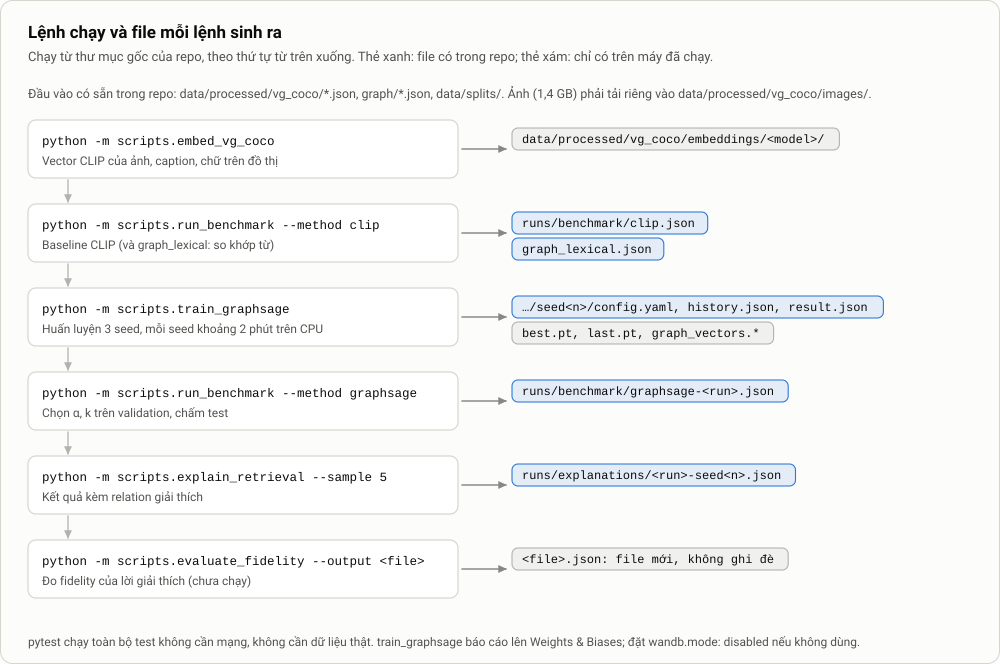

# 5. Chạy lại và bản đồ code

## Chuẩn bị

- Python 3.12 trở lên, vì code dùng cú pháp generic có từ Python 3.12.
- Cài thư viện bằng `pip install -r requirements.txt`. Danh sách gồm torch, torch_geometric, transformers, faiss-cpu, scikit-learn, wandb, pytest, ruff, mypy và một số thư viện khác.
- Chạy mọi lệnh **từ thư mục gốc của repo**, theo dạng `python -m scripts.<tên>`, vì đường dẫn trong config được tính từ thư mục gốc.
- `train_graphsage` gửi báo cáo lên Weights & Biases khi dùng config mặc định, vì `configs/retrieval/vg_coco.yaml` đặt `wandb.mode: online`. Nếu không dùng W&B, đổi giá trị này thành `offline` hoặc `disabled`. Các config ablation đã đặt sẵn `disabled`.

## Lệnh và file sinh ra



**Pipeline chính:**

```bash
python -m scripts.embed_vg_coco                          # vector CLIP của ảnh, caption và chữ trên đồ thị (khoảng 3 phút trên MPS)
python -m scripts.run_benchmark --method clip            # baseline CLIP
python -m scripts.run_benchmark --method graph_lexical   # CLIP + so khớp từ (graph_lexical_objects: chỉ dùng khái niệm)
python -m scripts.train_graphsage                        # 3 seed; thêm --seed 13 để chỉ chạy một seed
python -m scripts.run_benchmark --method graphsage       # CLIP + GraphSAGE, đọc vector đồ thị của mọi seed
python -m scripts.explain_retrieval --sample 5           # 5 truy vấn test ngẫu nhiên, kèm relation giải thích
pytest                                                   # toàn bộ test, không cần mạng
```

**Ablation:** mỗi biến thể có một config trong `configs/retrieval/ablations/`:

```bash
for variant in full objects_only drop_predicates random_edges undirected; do
  python -m scripts.train_graphsage --config "configs/retrieval/ablations/${variant}.yaml" --resume || break
  python -m scripts.run_benchmark --method graphsage --config "configs/retrieval/ablations/${variant}.yaml" || break
done
python -m scripts.analyze_ablation                       # so sánh ghép cặp + bootstrap → runs/analysis/ablation.json
```

**Kiểm tra lời giải thích:**

```bash
python -m scripts.evaluate_fidelity --config configs/evaluation/fidelity.yaml   # → runs/fidelity/full-joint-test.json
python -m scripts.evaluate_explanation_quality           # sparsity, keep-only → runs/explanation-quality/
python -m scripts.evaluate_explanation_quality --labels review-v1.json   # tổng hợp nhãn validity đã có
python -m scripts.prepare_validity_review --all          # gói dữ liệu cho form chấm tools/validity-review/index.html
```

**Vẽ lại các hình của tài liệu này:**

```bash
python -m scripts.make_doc_figures                       # đọc runs/ và data/processed/, ghi docs/images/*.svg
```

Biến thể có đỉnh ảnh mang vector CLIP:

```bash
python -m scripts.train_graphsage --image-node clip_image
python -m scripts.run_benchmark --method graphsage --run directed-clip_image-l3-h512
```

Các tuỳ chọn hay dùng của `train_graphsage`:

| Tuỳ chọn | Tác dụng |
|---|---|
| `--config` | File config. Mặc định là `configs/retrieval/vg_coco.yaml`; ablation dùng các file trong `configs/retrieval/ablations/` |
| `--resume` | Bỏ qua seed đã xong; seed bị ngắt thì chạy tiếp từ `last.pt` và cho kết quả trùng với lượt chạy liền mạch |
| `--overwrite` | Xoá lượt cũ của seed rồi chạy lại từ đầu |
| `--seed N` | Chỉ chạy seed N (có thể lặp lại để chạy nhiều seed) |
| `--image-node clip_image` | Chạy biến thể có đỉnh ảnh mang vector CLIP |

Script từ chối chạy trong các trường hợp sau:

- thư mục của lượt chạy đã tồn tại mà không có `--resume` hay `--overwrite`;
- dùng `--resume` khi config đã thay đổi (trừ các trường `max_epochs`, `patience` và `seeds`);
- dùng `--resume` cho một lượt đã báo xong nhưng thiếu file.

Không dùng `--name` để ghi một biến thể vào thư mục của bản đầy đủ. Tên lượt chạy tự phân biệt biến thể, ví dụ `directed-learned-l3-h512-objects_only-a0`.

## Cái gì có trong repo, cái gì phải tự tạo

| Có sẵn trong repo | Phải tự tạo trên máy |
|---|---|
| JSON dữ liệu đã xử lý: `data/processed/vg_coco/*.json`, `graph/*.json`, `data/splits/` | 10.000 file ảnh (1,4 GB) trong `data/processed/vg_coco/images/` |
| Kết quả benchmark: `runs/benchmark/*.json`, gồm cả 4 biến thể ablation | Vector CLIP, bằng `embed_vg_coco` |
| `config.yaml`, `history.json`, `result.json` của từng seed | Checkpoint `*.pt` và `graph_vectors.*`, bằng `train_graphsage` |
| Kết quả giải thích: `runs/explanations/*.json` | Kết quả phân tích ablation, fidelity, sparsity: `runs/analysis/`, `runs/fidelity/`, `runs/explanation-quality/` |
| Config: `configs/data/`, `configs/retrieval/`, `configs/retrieval/ablations/`, `configs/evaluation/` | Báo cáo và gói chấm validity riêng tư: `private/` |

Về `.gitignore`:

- `.gitignore` bỏ qua `/runs/` và `/private/`, nên mọi output **mới** chỉ nằm trên máy. Các file đã được theo dõi từ trước trong `runs/` vẫn được Git theo dõi. Muốn đưa một file kết quả mới vào repo thì phải chủ động `git add -f`.
- Các file nén ở thư mục gốc, ví dụ `runs.zip` (bản lưu thí nghiệm cũ), cũng bị bỏ qua vì quá lớn; hãy chia sẻ chúng qua kênh khác.

Hai script dựng dữ liệu không nằm trong repo: `scripts/build_vg_coco.py` (tải ảnh và dựng dữ liệu) và `scripts/review_vg_coco.py` (duyệt dữ liệu). Các module mà chúng dùng (`src/data/`) và test của các module đó thì có. Từ đó:

- Muốn chạy `embed_vg_coco` thì phải có sẵn 10.000 file ảnh.
- Mọi lệnh dùng mô hình đã huấn luyện (`run_benchmark --method graphsage`, `explain_retrieval`, `analyze_ablation`, `evaluate_fidelity`, `evaluate_explanation_quality`) cần đã chạy `train_graphsage` trên máy, vì checkpoint và vector đồ thị không được commit. Các lệnh này kiểm tra sha256 và nguồn gốc của artifact trước khi chạy (`src/models/run_validation.py`).
- Nếu gặp lỗi SSL khi tải ảnh bằng Python cài qua uv, đặt biến `SSL_CERT_FILE` trỏ tới file `certifi/cacert.pem`.

## Bản đồ code

| Thư mục | Vai trò | File chính |
|---|---|---|
| `configs/` | Chứa mọi tham số dưới dạng YAML; trong code không có số nào viết cứng | `data/vg_coco.yaml`, `retrieval/vg_coco.yaml`, `retrieval/ablations/*.yaml`, `evaluation/fidelity.yaml`, `evaluation/explanation_quality.yaml` |
| `src/core/` | Các ngoại lệ dùng chung và hàm đọc config | `exceptions.py`, `config_parsing.py` |
| `src/data/` | Dựng dữ liệu: tải, ghép, chuẩn hoá synset, chia tập, xây đồ thị | `graph_build.py`, `splits.py`, `synsets.py`, `vg_coco_join.py` |
| `src/embeddings/` | CLIP đóng băng; bảng vector lưu trên đĩa (gồm ma trận, danh sách id và sha256) | `clip_encoder.py`, `store.py` |
| `src/models/` | Đồ thị con, GraphSAGE, biến thể ablation, huấn luyện, checkpoint, kiểm tra artifact, giải thích | `graph_data.py`, `graphsage.py`, `ablations.py`, `train.py`, `checkpoint.py`, `run_validation.py`, `explain.py` |
| `src/retrieval/` | Trộn điểm và quét α, k; so khớp từ; đọc config | `rerank.py`, `lexical.py`, `config.py` |
| `src/evaluation/` | R@K, MRR; chấm điểm theo từng tập; phân tích ablation; fidelity; sparsity và validity | `metrics.py`, `benchmark.py`, `ablation_analysis.py`, `fidelity.py`, `explanation_quality.py`, `validity_audit.py` |
| `src/connectors/` | Kết nối Weights & Biases | `wandb_tracker.py` |
| `scripts/` | Các lệnh chạy ở trên; `make_doc_figures.py` vẽ hình cho `docs/` | |
| `tools/validity-review/` | Form offline để người chấm validity | `index.html`, `README.md` |
| `tests/` | Test, chia thư mục theo cấu trúc của `src/`; dùng đồ thị dựng tay và bộ mã hoá giả | |

Các tài liệu quản lý dự án:

| File | Nội dung |
|---|---|
| `task.md` | Bảng việc: ai làm gì, việc nào đã xong |
| `plan-task/requirements-checklist.md` | Tiến độ nghiệm thu theo từng yêu cầu của đề |
| `plans/261117-0037-multimodal-graph-retrieval-roadmap/` | Kế hoạch từng phase, kèm bảng tiến độ và bằng chứng |
| `docs/graphsage-design-decisions.md` | Quyết định thiết kế, giao thức ablation và fidelity, số liệu đã quan sát |
| `docs/build_MMKG.md` | Hướng dẫn xây MMKG tiếng Việt (Cấp độ 3) |
| `agents/AGENTS.md` | Quy tắc cho agent và nhật ký các lượt chạy |

Quy ước của code:

- Hàm thuần không đọc hay ghi file. Việc đọc/ghi nằm trong các hàm load/save và trong `scripts/`.
- Lỗi được báo bằng ngoại lệ riêng (`ConfigError`, `DataError`, `TrainingError`) ngay tại nơi phát hiện. Mỗi script bắt lỗi một lần và trả mã lỗi 1.
- Config được đọc thành dataclass bất biến và được kiểm tra hợp lệ ngay khi đọc.
- Tên biến, log và comment viết bằng tiếng Anh; tài liệu và kế hoạch viết bằng tiếng Việt.

## Kiểm tra chất lượng

```bash
pytest                              # toàn bộ test
pytest tests/retrieval              # test của một thư mục
pytest tests/retrieval/test_rerank.py::test_alpha_one_keeps_the_clip_ranking_for_any_k   # một test
ruff check .                        # lint
mypy                                # kiểm tra kiểu cho src/ và scripts/
```

Chất lượng của bộ test đã được kiểm bằng cách cố ý gài lỗi vào code. Ví dụ, test xếp hạng lại bắt được 12/12 lỗi gài, test huấn luyện bắt được 17/17.
