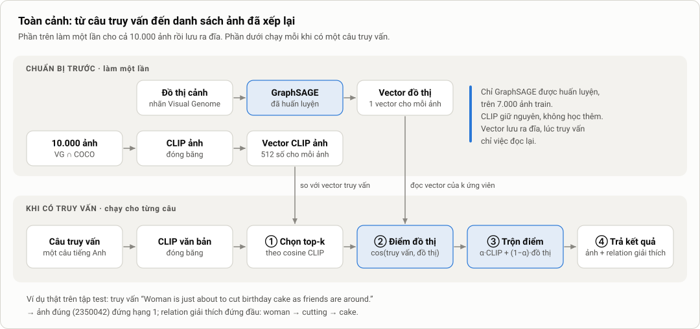

# Tài liệu dự án: tìm ảnh bằng câu mô tả, xếp hạng lại bằng đồ thị cảnh

Cập nhật ngày 18/11/2026. Mọi con số lấy từ các file trong `runs/` và `data/` tại thời điểm này.

## Dự án trong một phút

- **Bài toán.** Cho một câu tiếng Anh, ví dụ *"Woman is just about to cut birthday cake as friends are around."*, tìm đúng tấm ảnh mà câu đó mô tả trong 1.500 ảnh.
- **Cách làm.**
  - CLIP chấm độ giống giữa câu và từng ảnh rồi chọn ra các ứng viên.
  - Mỗi ứng viên được chấm thêm một **điểm đồ thị**. Đồ thị cảnh của ảnh ghi lại có những vật gì và vật nào làm gì với vật nào. GraphSAGE nén đồ thị đó thành một vector, rồi vector này được so với câu.
  - Điểm cuối = α · điểm CLIP + (1 − α) · điểm đồ thị.
- **Kết quả.**
  - Tỉ lệ truy vấn có ảnh đúng ở hạng 1 (R@1) tăng từ **43,89%** khi chỉ dùng CLIP lên **48,20%** khi thêm GraphSAGE.
  - Kết quả ổn định qua 3 lần huấn luyện (± 0,05).
  - Trên 7.500 truy vấn test, có thêm khoảng 320 câu tìm đúng ảnh ngay ở hạng 1.
- **Giải thích.** Mỗi ảnh trả về kèm các relation mà khi bỏ đi thì điểm đồ thị giảm nhiều nhất. Với truy vấn ở trên, relation đứng đầu là `woman → cutting → cake`.
- **Đang làm.**
  - Đã có code đo độ trung thực (fidelity) của lời giải thích, và code biến đổi đồ thị cho ablation.
  - Chưa có kết quả cho hai phần này.
  - Vì vậy chưa thể nói phần cải thiện đến từ *quan hệ* hay chỉ từ *danh sách đối tượng*.

## Đọc theo thứ tự nào

| # | Tài liệu | Trả lời câu hỏi |
|---|---|---|
| 1 | [Bài toán và ý tưởng](01-bai-toan-va-y-tuong.md) | Hệ thống làm gì? Vì sao cần thêm đồ thị? Thuật ngữ và cách đo |
| 2 | [Dữ liệu](02-du-lieu.md) | Ảnh và câu truy vấn lấy từ đâu? Đồ thị được xây thế nào? Làm sao để dữ liệu test không bị rò rỉ? |
| 3 | [Mô hình](03-mo-hinh.md) | Đồ thị của một ảnh trông thế nào? GraphSAGE học gì? Chấm điểm và giải thích ra sao? |
| 4 | [Kết quả hiện có](04-ket-qua.md) | Các con số, biểu đồ, cách đọc cho đúng, điều gì chưa chứng minh được |
| 5 | [Chạy lại và bản đồ code](05-chay-lai-va-ban-do-code.md) | Lệnh nào sinh ra file nào? Code nằm ở đâu? |
| A | [Phụ lục A: kiến thức nền, công thức và ví dụ](phu-luc-a-kien-thuc-nen.md) | Cosine, CLIP, R@K và MRR, đồ thị, GraphSAGE, InfoNCE, AdamW, độ lệch chuẩn, rò rỉ dữ liệu, fidelity, ablation… mỗi mục có ví dụ bằng số |
| B | [Phụ lục B: tính tay một ví dụ từ đầu đến cuối](phu-luc-b-tinh-tay-tu-dau-den-cuoi.md) | Từng con số đi qua hệ thống thế nào: từ vector của chữ tới GraphSAGE, điểm cuối, hạng, lời giải thích và loss |

Nếu muốn nắm nhanh, đọc mục này và tài liệu 4. Nếu gặp khái niệm lạ, tra Phụ lục A. Nếu sắp sửa code, đọc thêm tài liệu 3 và 5.

## Một ví dụ dùng xuyên suốt

Các tài liệu dùng chung một ví dụ thật trong tập test:

- **Truy vấn** `coco-659101`: *"Woman is just about to cut birthday cake as friends are around."*
- **Ảnh đúng** là ảnh Visual Genome `2350042`. Đồ thị cảnh của nó có 15 đối tượng và 6 relation, trong đó có `woman → cutting → cake` và `candle → on → cake`.
- **Kết quả.** CLIP đã xếp ảnh này ở hạng 1; sau khi xếp lại, ảnh vẫn ở hạng 1. Relation giải thích đứng đầu là `woman → cutting → cake`.

## Tài liệu có sẵn từ trước

| File | Nội dung |
|---|---|
| [graphsage-design-decisions.md](graphsage-design-decisions.md) | Lý do của từng quyết định thiết kế G1–G10 |
| [diagrams/graphsage-how-it-works.html](diagrams/graphsage-how-it-works.html) | Bấm qua từng tầng GraphSAGE trên đồ thị của một ảnh thật (mở bằng trình duyệt) |
| [diagrams/graphsage-pipeline.html](diagrams/graphsage-pipeline.html) | Sơ đồ tương tác của pipeline |
| [../reports/data-review/index.html](../reports/data-review/index.html) | Báo cáo duyệt dữ liệu VG ∩ COCO |
| [../plans/261117-0037-multimodal-graph-retrieval-roadmap/plan.md](../plans/261117-0037-multimodal-graph-retrieval-roadmap/plan.md) | Kế hoạch 8 phase, tiến độ và bằng chứng của từng bước |

## Về các hình

Các hình trong `images/` được vẽ bằng lệnh `python -m scripts.make_doc_figures`, từ chính các file kết quả: `runs/benchmark/*.json`, `runs/graphsage/*/seed*/history.json`, `runs/explanations/*.json` và `data/processed/vg_coco/graph/*.json`. Khi có kết quả mới, chạy lại lệnh này để cập nhật biểu đồ. Hình nào là minh hoạ dùng số giả định thì có ghi rõ ngay trên hình.
